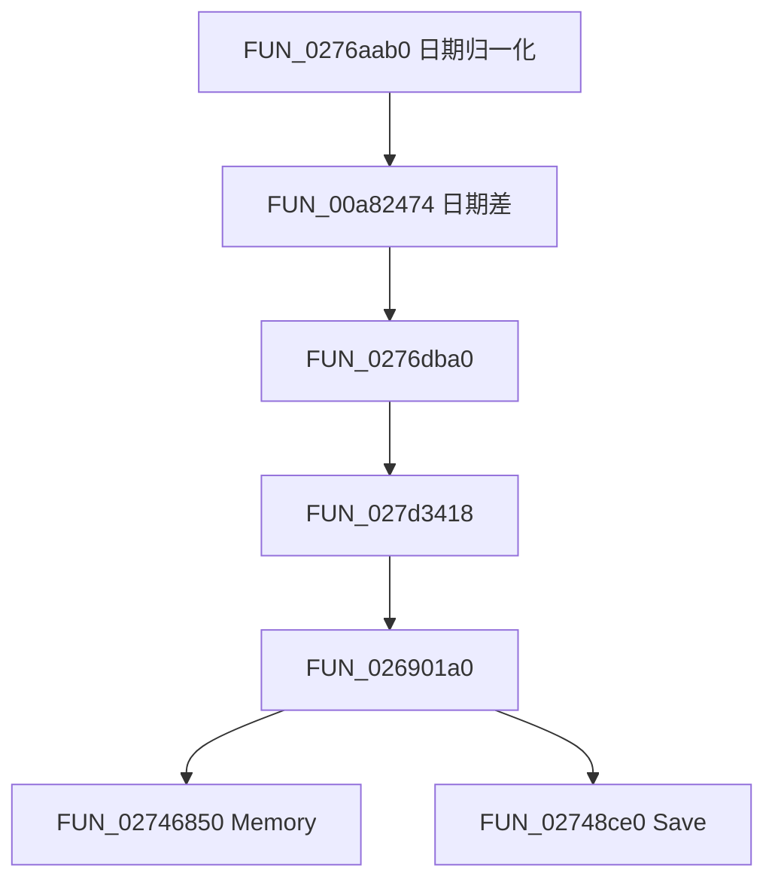

# R96 补充 · 日期重置、访问枚举与 TalkValue

[[00-Home|知识库主页]] · [[25-R92-Villager-Encyclopedia-Recruitment-Save-Evidence|R92]]

本次基于已合并 R95/R96，不替换原版证据。逐条读取 371 条定义，并重新核对 10 个 Ghidra C 文件。保存源 Git blob、行号、原始文本和 67 条 TalkValue 数据。未读取实际游戏存档或运行时。

## P0：日期与条件重置

FUN_0276aab0 将当前 CalendarTime 若小时 <5 则先减去 86400 秒，再设置 05:00:00；FUN_00a82474 计算两个 CalendarTime 的有符号整日差。可据此确定该调度路径的游戏日边界为 05:00，而不是自然日午夜。现有旧日期结构的所有写入者仍需追踪。



**新增静态候选**：`local_10d6 = param_1 == 1`；传入上下文是 `&local_1100`，Ghidra 栈名差 0x1100 - 0x10d6 = 0x2a，恰为两处重置函数的额外标志。mode=1 对应具体何种游戏事件仍未知；需要核对 ARM64 栈布局和调用者。特别是 FUN_026901a0 对 Save 重置的反编译省略了第二参数，不应在未查看寄存器数据流前宣称该调用链已逐指令证明。

| rule | NPC Memory | NPC Save | 条件 |
| --- | ---: | ---: | --- |
| 0 | 62 | 40 | 此路径不重置 |
| 1 | 96 | 24 | 日期差非零 |
| 2 | 7 | 0 | 日期差非零或 +0x2A 非零 |
| 3 | 2 | 1 | 此函数执行时无条件 |
| 4 | 0 | 0 | 日期差为正 |

rule 2 仅七个 Memory 定义：`SitBenchFlag`、`ContinuousTalkCount`、`Again2Count`、`StandingUpFlag`、`StoodUpFlag`、`OrderQuest`、`TalkCountInFacilityToday`。

原版列名仍为 null；不把 conditional_reset_rule 或 mode 别名作为官方名称。

## P0：FlagsFlowAccess

| 作用域 | 0 | 1 | 2 | 合计 |
| --- | ---: | ---: | ---: | ---: |
| npc_memory | 9 | 7 | 151 | 167 |
| npc_save | 23 | 7 | 35 | 65 |
| npc_temp | 5 | 13 | 54 | 72 |
| player_activity | 67 | 0 | 0 | 67 |
| 合计 | 104 | 27 | 240 | 371 |

这是定义分布，不是读写权限真值表。R95 已有 scoped AccessKey 扫描。新增工具允许全 C 导出中对两个 TalkValue、MessageLabel 与访问/重置字段做正负十六进制统一扫描；数值命中仅列为候选。该扫描尚未运行。

## P1：TalkValue 67 条原始数值

全部位于 PlayerActivity，67 条居民侧均非零；29 条访客侧非零、38 条为零。每条保留 UniqueID、Key、原版日文、MaxValue、MessageLabel、两种 TalkValue。例：

| Key | MaxValue | Villager | Visitor |
| --- | ---: | ---: | ---: |
| PlayTime | 720 | 180 | 60 |
| GetFishCount | 128 | 40 | 15 |
| UseReactionCount | 256 | 100 | 100 |
| TalkNpc0Count | 64 | 20 | 0 |
| PlantMoneyFlag | 1 | 1 | 0 |
| GetMiles | 64 | 32 | 0 |
| TurnipSellPrice | 1000 | 300 | 300 |

这些可能是活动对话触发或评价参数；不能仅从数值断言阈值、时间单位、权重或访客零值的含义。先找两个 Hash 的真实字段读取者，再验证比较操作、转换单位与消息标签。

## Friendship 的运算边界

FUN_021d7650 反编译先对 u32 状态加 signed delta，按无符号比较计算候选等级，若等级降低，读取 UNK_04179ca0[old_level-1]。随后 FUN_0265d830 调用 FUN_02747170，后者按 signed int 将值限在 0..MaxValue。不能简化成先限幅再判级；尤其下溢和跨级下降需要 ARM64 指令与真实 table bytes 对照。R96 已有提取脚本，本次不凭空填写六个元素。赠礼、照片概率及招募 callback 仍待实证。

## 复现

```powershell
python Scripts/acnh303_r96_calendar_audit.py --root . --out artifacts/r96-calendar-audit.json
python Scripts/acnh303_r96_calendar_audit.py --root . --out artifacts/r96-calendar-native-scan.json --scan-native
```

[机器可读审计](https://github.com/969981/ACNH_Resources/blob/research/r96-calendar-talkvalue-audit-20261124/derived/3.0.3/npc_event_flags/r96_calendar_audit/audit.json) · [R95](https://github.com/969981/ACNH_Resources/tree/3.0.3_Unpack/derived/3.0.3/npc_event_flags/r95) · [R96](https://github.com/969981/ACNH_Resources/tree/3.0.3_Unpack/derived/3.0.3/npc_event_flags/r96)

所有实际状态仍为 null；不升级为 L4、不增加运行时覆盖率。
