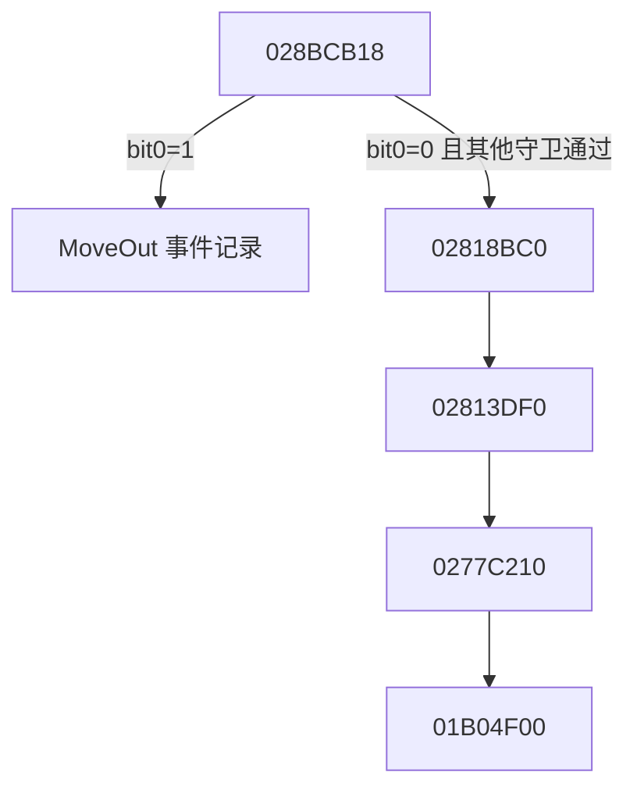

# 特殊道具行为与 CantTakeOver 调用链研究

[[00-Home]] · [[ACNH303_R84_RUNTIME_ITEM_RESTRICTIONS_EVIDENCE]] · [[ACNH303_R84_ITEMPARAM_107_FIELDS_SOURCE_AND_EXPORT]] · [[Native-Pointer-Research-3.0.3/29-PutUnitIcon物品资格与放置结果边界]] · [[Native-Pointer-Research-3.0.3/13-跨岛派送背包扣减与道具环证据]]

## 1. 研究目标与边界

将进入背包、普通地面投放、拾取、家具摆放、收纳、销毁、玩家数据继承、普通联机跨岛携带分开建模。目标是支持全部 11,178 个原版道具的 ItemCapabilityCore，而非以第三方网站类别或一个布尔值决定派送。
本轮实际读取仓库 Ghidra C、ItemKind CSV/JSON、菜单资源与机场 EventFlow；未重新执行 ELF 全量 XREF、未进行实机测试、未构建全量数据库。VA 为 Ghidra 地址；Main RVA = VA - 0x100000。所有函数语义名为研究命名。Git blob SHA 是内容对象标识，并非原始文件 SHA256。

## 2. 用户样本

历史工作表 web_db_multi_other.xlsx：361 道具，208 黄色正样本，153 未标记（未知，不能等同实测负样本），35 类别。此前分析记录中 CanSetItem=1 覆盖黄色 208，另外 29 未标记亦满足；CanSetItem=0 的 124 未标记。标记吻合率 332/361=91.97%，不是实机行为成功率。本轮未重新读取工作表，以上为历史记录、待脚本复核；不发布用户原始工作表。此前组合公式 CanSetItem && (CanFtr || (CanSetInTrashBox && !CantTakeOver)) 至少有 ShopTorso 反例，不能认作原版规则，也不能用同一批样本拟合并宣称泛化。HousePost、DummyWrapping、ShopTorso 应单独验证。

## 3. 行为分派与静态证据

[ItemKind CSV](../UnPack/1/Bcsv/ItemKind.csv)（blob bee0408c96266c5b21f27d43bfe9d44a598aad7c）、[元数据](../UnPack/1/Bcsv/ItemKind.json)（189 行，152 bytes/row）；[R74 字段恢复](../Scripts/acnh303_r74_metadata_stack_research.py)。字段名由 CRC32(name+" u8") 恢复。以下偏移是 BCSV 行内偏移，不是对象内存偏移缓存。

|Case|字段|CRC32|行内偏移|
|---:|---|---|---|
|0/1|CanSetItem|49129B27|0x30|
|2|CanSetChest|DAE27694|0x2D|
|3|CanSetCloset|1BCD4858|0x2E|
|4|CanFtr|90BC0855|0x24|
|5|CanPut|5D389FBF|0x29|
|6|CanBury|472724ED|0x22|
|7|CanPlant|D4697FF8|0x28|
|8|CanSell|3D4F3F42|0x2B|
|9|CanSellSimple|B52FE52E|0x2C|
|10|CanGift|06012035|0x25|
|11|CanEat + 特殊分支|9B433DD5|0x23|

[01B12E40](../derived/3.0.3/ghidra12.2/c/2e/01b12e40.c) blob cd62dcba9aa482435f03c5b98f6df6e7dc677276；Case 0 在 switch 后处理，Case 11 转 [01B04AB0](../derived/3.0.3/ghidra12.2/c/4a/01b04ab0.c)，有额外映射判断。0317E7E0 还消费 PlayerEnableEating。不能把 12 个 case 等同 18 个静态旗标。

[01B14730](../derived/3.0.3/ghidra12.2/c/47/01b14730.c) 读取 CanSetItem；[0277E788](../derived/3.0.3/ghidra12.2/c/e7/0277e788.c)、[0277E8B4](../derived/3.0.3/ghidra12.2/c/e8/0277e8b4.c) 两分区调用该 Getter；[0277E9E0](../derived/3.0.3/ghidra12.2/c/e9/0277e9e0.c) 对普通非空记录还调用 [01B14990](../derived/3.0.3/ghidra12.2/c/49/01b14990.c) 读取 CanSetChest。空记录 0xFFFE 另有特殊分支。只确认静态校验，不等于玩家在任意场景能执行操作。

## 4. CantTakeOver：本轮重点

[01B04F00](../derived/3.0.3/ghidra12.2/c/4f/01b04f00.c) blob 7e3ffddcf26faa12d288f45b95a113c4ca45c268：CRC32 C37A683C（有符号 -0x3C8597C4），行内偏移 0x33，字段偏移缓存 +0x68。正常字段解析后返回 byte == 0，即 CantTakeOver 的反值。缺失字段、空指针、默认索引等存在不同返回分支，不将整个函数简化为 !flag。

[0277C210](../derived/3.0.3/ghidra12.2/c/c2/0277c210.c) blob fc3d142fd1a54b728df494f85f42624a26a1130e：遍历 count 个经虚函数取得的 8 字节记录，先检查资源目录，再调用 01B04F00；返回 false 时复制全局默认记录 PTR_DAT_04bb37e0；返回 true 时还可能按类别转换。它是容器过滤与转换器，而非已证机场携带判定。
[02813DF0](../derived/3.0.3/ghidra12.2/c/3d/02813df0.c) blob a3fa2524ffde78922409ce8e8d305e3e1e040967：调用三次 0277C210，随后清理多组状态。
|容器候选起点|数量字段|上限|
|---|---|---:|
|+0xC8|+0x168|20|
|+0x10|+0xB0|20|
|+0x18C|+0x11ACC|9000|
两个背包分区及仓库是强结构候选，不能把该对象的基址与此前单独 inventory payload 基址混用。

[02818BC0](../derived/3.0.3/ghidra12.2/c/8b/02818bc0.c)：处理玩家后端描述符，调用 027EFF98、0274F840、027A5750，选择 player+0x194B0 或全局默认后端；由后端 +8 与 +0x10 两值相加获取数据地址，调用 02813DF0。另有回调守卫及 027EA950 数据处理。描述符大小出现 0x37AD0、0x3CE60、0x1E3388。

### 新增上层：028BCB18

[028BCB18](../derived/3.0.3/ghidra12.2/c/cb/028bcb18.c) blob 41341794857b38724577cdf2357142e8a02f98fe。param_1 bit0=1 分支获取玩家索引（<8）、记录表及 LE_PlayerVillager_MoveOut，调用 0281CB30 后返回。该字符串在 [MemoriesEventInfoLand.csv](../UnPack/1/Bcsv/MemoriesEventInfoLand.csv) 第51索引行存在，邻近 NewPlayerVillager、MoveIn。
bit0=0 分支调用 026F52AC、026F66E0、026F5394，按全局管理对象 +0x94..+0x124 状态值 2 选择多个数据对象，检查多个非空对象以及额外 bit 条件，最终调用 02818BC0。两个分支互斥；MoveOut 字符串支持玩家搬家/迁移生命周期假说，但不能证明 bit0=0 的确切场景，也不能证明普通机场旅行一定不调用此链。

|VA|Main RVA|证据|
|---|---|---|
|028BCB18|027BCB18|上层分支及 MoveOut 字符串|
|02818BC0|02718BC0|后端数据处理|
|02813DF0|02713DF0|三容器过滤|
|0277C210|0267C210|记录过滤与转换|
|01B04F00|01A04F00|反向许可 Getter|

GitHub C 索引仅命中 028BCB18 自身定义，未恢复其上游直接/间接引用；不是完整 ELF XREF。对照 [机场 DepartVisitor EventFlow](../UnPack/1/EventFlow/SNPC_dod_30_Airport_DepartVisitor.json)（blob b775e1c86a960b8931de703606f0517a9c4b7d65），EntryPoint_Depart 中有 EventFlowActionNetEnterVillage、EventFlowActionOpenVillageGate，未在该资源中找到上述过滤函数的对应 Native 边。不能将没有文本引用当作不存在调用。

### 特殊记录转换候选

已读 CSV 行 0x8A JohnnyQuest、0x8C PirateQuest、0x8D QuestWrapping、0x8F LostQuest、0x92 TreasureQuest。0277C210 中相应索引分支存在 0x955、0x9F2、标志修改及 01B06140 调用。CSV 行序与 runtime 映射仍需核对；目标 ID 的原版名称未确认。必须同时验证实际到达性（前置 CantTakeOver 检查）。

## 5. 普通投放、家具、丢弃与收纳

[01B045F0](../derived/3.0.3/ghidra12.2/c/45/01b045f0.c) 和 [01B04850](../derived/3.0.3/ghidra12.2/c/48/01b04850.c) 都读取 CanPut 5D389FBF（行内 0x29，缓存 +0x40）；后者由 0277E688 调用。[0317E7E0](../derived/3.0.3/ghidra12.2/c/e7/0317e7e0.c) blob ee7bc2d47fb7e5010bd97e00f49decbff21ac1f2：0277E688 通过且其他条件成立时加入命令 30。已有 [第29章](Native-Pointer-Research-3.0.3/29-PutUnitIcon物品资格与放置结果边界.md) 记录 CI 45343034553 原始指令交叉验收；本轮未重新运行该 CI。

[ItemUIContextMenu.csv](../UnPack/1/Bcsv/ItemUIContextMenu.csv) blob f0a408702901d29aac0e53cc4e146554677e72c9：
|菜单|Native index|CSV ID|分派索引|Handler VA|
|---|---:|---:|---:|---|
|PutUnitIcon|30|10|10|0317513C|
|PutFtr|23|11|11|031752C0|
|Throw|42|33|28|03176698|
|ToStorage|49|18|29|03176D78|
编号空间不同；引用 [[Native-Pointer-Research-3.0.3/26-菜单资源根发布与普通物品分发]]、[[Native-Pointer-Research-3.0.3/28-菜单名称指针表与Native编号]]。CanPut 是菜单候选条件之一，非充分条件；Throw 不等于 PutUnitIcon，亦未确认最终销毁逻辑。地面写入、通知、背包扣减及持久化需独立确认。

## 6. 获取链

[0242E2CC](../derived/3.0.3/ghidra12.2/c/e2/0242e2cc.c) blob 2c5b75bd780e19aaff0d391171b2f593b0acc8e9：构建 Player_GetDemo/Get_Pickup，后段转换 016E49E4 并在资源有效条件下调用 026738B0。
[0242B9E8](../derived/3.0.3/ghidra12.2/c/b9/0242b9e8.c) blob f5831ab43409443c293e51366aa619b33355d8bd：存在 0277D9A8、01B0E0EC、01B09BEC 分流以及 024F43CC 特殊路径（MainmenuRecipe、随机运算），非单纯通用拾取许可。
[024C2540](../derived/3.0.3/ghidra12.2/c/25/024c2540.c) blob a81af1010b3f4c86ff451f273ccbb1cb953075c1：Get_Pickup、Get_Scoop、FullItem_Plant 事件分流。
[016E49E4](../derived/3.0.3/ghidra12.2/c/49/016e49e4.c) blob b39926808aa48accb427fc7322d1d3c0109dc4be：复制并转换8字节记录，调用 0277E56C 或特殊目录转换，失败输出默认记录。
[0232697C](../derived/3.0.3/ghidra12.2/c/69/0232697c.c) blob 9ca51194b7d2f9202215829a4bb960d811957256：场景/身份条件、记录转换、0277E788、类别索引 0x86 特殊分支调用 0267BA70，否则 02677890；失败路径亦可能返回1，返回值极性必须结合调用者，不命名 CanPickUp。CSV 行0x86=Money，仅为类别候选。
[026738B0](../derived/3.0.3/ghidra12.2/c/38/026738b0.c) blob 261a1089d197c38452854022f8c0e9a3d9714615：身份及目录验证，再调用 [02673A50](../derived/3.0.3/ghidra12.2/c/3a/02673a50.c)，其下调用 027FAA50、02674040/02673DE0、02674420；需进一步证明添加结果与现场移除事务。
[Player_GetDemo](../UnPack/1/EventFlow/Player_GetDemo.json) 包含 cPickupFull、cExchangeByPickup、EventFlowQueryPlayerHasExchaneableItem。事件入口不等于最终资格。

## 7. ItemCapabilityCore 建议结构（未实现）

独立保留 item_identity、item_kind_rule、native_capability_dispatch、native_function/xref、item_capability、item_scene_capability、item_runtime_observation、item_user_observation、item_delivery_policy、evidence_source。
分离 raw flags、native predicates、scene observations 与产品策略；未知为 NULL。每条行为记录需要版本、Build ID、item ID、kind、实例状态、角色、场景、操作、来源、证据等级。can_set_inventory、can_store_static、can_drop_menu_candidate、can_takeover_predicate 等静态字段不得覆盖 can_pickup、can_drop、can_place、can_transfer_online 实际行为字段。机器人资格只在自身业务验证后启用；无证据默认待审核，不自动宣称非法。
证据等级 USER_OBSERVED、ROM_STATIC、NATIVE_STATIC、ELF_BYTE_VERIFIED、RUNTIME_VERIFIED 各自独立。此前 R84 的 11,178 道具及107字段是全量构建基线，本轮没有新生成数据库。

## 8. 下一阶段任务与验收

|ID|优先级|任务|验收标准|
|---|---|---|---|
|CAP-01|P0|028BCB18 上游 XREF、虚表及参数来源|原始 ELF BL/BLR、调用对象和 bit0 来源；证实触发场景|
|CAP-02|P0|028BCB18 两分支生命周期|0281CB30、026F52AC/66E0/5394、状态2消费者；区分迁移和初始化|
|CAP-03|P0|机场旅行独立链|正常出发、返航、访客、岛主事件与 Native 绑定；与过滤链交叉验证|
|CAP-04|P0|0277C210 完整类别转换|原始映射、前置条件、目标 ID 来源；不以 CSV 行号代替 runtime 类型|
|CAP-05|P0|普通获取与 PutUnitIcon|0232697C 返回极性、016E49E4、027FAA50、Field 写入/持久化、01392D64 virtual+20|
|CAP-06|P0|样本对账|361 ID 精确联表、色标原值、异常类别及独立验证集；未标记保留未知|
|CAP-07|P1|特殊场景/模型/解锁|HousePost、ShopTorso、DummyWrapping、DummyHowtoBook、GardenEditList、PhotoStudioList|
|CAP-08|P1|全量 ItemCapabilityCore|11,178 ID 唯一，189 类别，原始 flag 完整，未知不填 false，导出 SQLite/JSON/CSV 与证据索引|
|CAP-09|P1|正常交互验证|授权测试环境的本地/访客场景观察；记录 UI、背包、Field 与保存结果，禁止据静态 flag 宣称交付成功|

复现：从原版 NSO/ELF 使用仓库已有转换脚本与原始字节双镜像工作流，固定 Build ID，扫描直接/间接引用、函数边界及 CFG；记录输入输出 SHA256 与 CI artifact。仓库既有第29章记录的 Build ID 为 ff1d1c05670db6021c85b624a710b96300000000000000000000000000000000，本轮未独立复算，不提高当前证据级别。所有运行时未知字段保持 NULL。此文档只记录研究，不修改生产机器人逻辑或原始资源。
