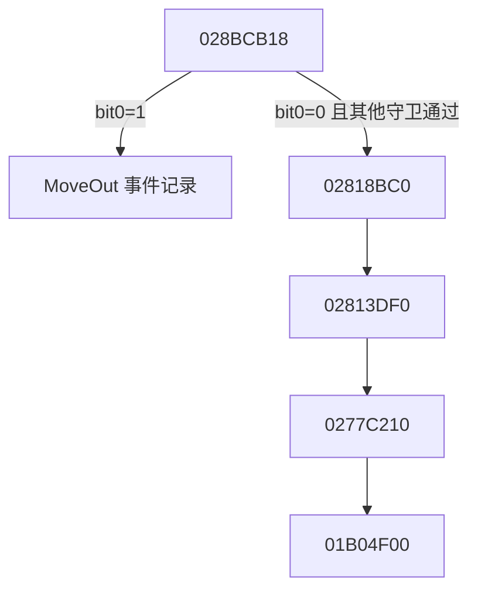

# 特殊道具行为与 CantTakeOver 调用链研究

[[00-Home]] · [[ACNH303_R84_RUNTIME_ITEM_RESTRICTIONS_EVIDENCE]] · [[ACNH303_R84_ITEMPARAM_107_FIELDS_SOURCE_AND_EXPORT]] · [[Native-Pointer-Research-3.0.3/29-PutUnitIcon物品资格与放置结果边界]] · [[Native-Pointer-Research-3.0.3/13-跨岛派送背包扣减与道具环证据]]

## 1. 研究目标与边界

将进入背包、普通地面投放、拾取、家具摆放、收纳、销毁、玩家数据继承、普通联机跨岛携带分开建模。目标是支持全部 11,178 个原版道具的 ItemCapabilityCore，而非以第三方网站类别或一个布尔值决定派送。
本轮实际读取仓库 Ghidra C、ItemKind CSV/JSON、菜单资源与机场 EventFlow；未重新执行 ELF 全量 XREF、未进行实机测试、未构建全量数据库。VA 为 Ghidra 地址；Main RVA = VA - 0x100000。所有函数语义名为研究命名。Git blob SHA 是内容对象标识，并非原始文件 SHA256。

## 2. 用户样本

历史工作表 web_db_multi_other.xlsx：361 道具，208 黄色正样本，153 未标记（未知，不能等同实测负样本），35 类别。此前分析记录中 CanSetItem=1 覆盖黄色 208，另外 29 未标记亦满足；CanSetItem=0 的 124 未标记。标记吻合率 332/361=91.97%，不是实机行为成功率。本轮未重新读取工作表，以上为历史记录、待脚本复核；不发布用户原始工作表。此前组合公式 CanSetItem && (CanFtr || (CanSetInTrashBox && !CantTakeOver)) 至少有 ShopTorso 反例，不能认作原版规则，也不能用同一批样本拟合并宣称泛化。HousePost、DummyWrapping、ShopTorso 应单独验证。

## 3. 行为分派与静态证据

[ItemKind CSV](../UnPack/1/Bcsv/ItemKind.csv)（blob bee0408c96266c5b21f27d43bfe9d44a598aad7c）、[元数据](../UnPack/1/Bcsv/ItemKind.json)（189 行，152 bytes/row）；[R74 字段恢复](../Scripts/acnh303_r74_metadata_stack_research.py)。字段名由 CRC32(name+" u8") 恢复。以下偏移是 BCSV 行内偏移，不是对象内存偏移缓存。

|Case|字段|CRC32|行内偏移|
|---:|---|---|---|
|0/1|CanSetItem|49129B27|0x30|
|2|CanSetChest|DAE27694|0x2D|
|3|CanSetCloset|1BCD4858|0x2E|
|4|CanFtr|90BC0855|0x24|
|5|CanPut|5D389FBF|0x29|
|6|CanBury|472724ED|0x22|
|7|CanPlant|D4697FF8|0x28|
|8|CanSell|3D4F3F42|0x2B|
|9|CanSellSimple|B52FE52E|0x2C|
|10|CanGift|06012035|0x25|
|11|CanEat + 特殊分支|9B433DD5|0x23|

[01B12E40](../derived/3.0.3/ghidra12.2/c/2e/01b12e40.c) blob cd62dcba9aa482435f03c5b98f6df6e7dc677276；Case 0 在 switch 后处理，Case 11 转 [01B04AB0](../derived/3.0.3/ghidra12.2/c/4a/01b04ab0.c)，有额外映射判断。0317E7E0 还消费 PlayerEnableEating。不能把 12 个 case 等同 18 个静态旗标。

[01B14730](../derived/3.0.3/ghidra12.2/c/47/01b14730.c) 读取 CanSetItem；[0277E788](../derived/3.0.3/ghidra12.2/c/e7/0277e788.c)、[0277E8B4](../derived/3.0.3/ghidra12.2/c/e8/0277e8b4.c) 两分区调用该 Getter；[0277E9E0](../derived/3.0.3/ghidra12.2/c/e9/0277e9e0.c) 对普通非空记录还调用 [01B14990](../derived/3.0.3/ghidra12.2/c/49/01b14990.c) 读取 CanSetChest。空记录 0xFFFE 另有特殊分支。只确认静态校验，不等于玩家在任意场景能执行操作。

## 4. CantTakeOver：本轮重点

[01B04F00](../derived/3.0.3/ghidra12.2/c/4f/01b04f00.c) blob 7e3ffddcf26faa12d288f45b95a113c4ca45c268：CRC32 C37A683C（有符号 -0x3C8597C4），行内偏移 0x33，字段偏移缓存 +0x68。正常字段解析后返回 byte == 0，即 CantTakeOver 的反值。缺失字段、空指针、默认索引等存在不同返回分支，不将整个函数简化为 !flag。

[0277C210](../derived/3.0.3/ghidra12.2/c/c2/0277c210.c) blob fc3d142fd1a54b728df494f85f42624a26a1130e：遍历 count 个经虚函数取得的 8 字节记录，先检查资源目录，再调用 01B04F00；返回 false 时复制全局默认记录 PTR_DAT_04bb37e0；返回 true 时还可能按类别转换。它是容器过滤与转换器，而非已证机场携带判定。
[02813DF0](../derived/3.0.3/ghidra12.2/c/3d/02813df0.c) blob a3fa2524ffde78922409ce8e8d305e3e1e040967：调用三次 0277C210，随后清理多组状态。
|容器候选起点|数量字段|上限|
|---|---|---:|
|+0xC8|+0x168|20|
|+0x10|+0xB0|20|
|+0x18C|+0x11ACC|9000|
两个背包分区及仓库是强结构候选，不能把该对象的基址与此前单独 inventory payload 基址混用。

[02818BC0](../derived/3.0.3/ghidra12.2/c/8b/02818bc0.c)：处理玩家后端描述符，调用 027EFF98、0274F840、027A5750，选择 player+0x194B0 或全局默认后端；由后端 +8 与 +0x10 两值相加获取数据地址，调用 02813DF0。另有回调守卫及 027EA950 数据处理。描述符大小出现 0x37AD0、0x3CE60、0x1E3388。

### 新增上层：028BCB18

[028BCB18](../derived/3.0.3/ghidra12.2/c/cb/028bcb18.c) blob 41341794857b38724577cdf2357142e8a02f98fe。param_1 bit0=1 分支获取玩家索引（<8）、记录表及 LE_PlayerVillager_MoveOut，调用 0281CB30 后返回。该字符串在 [MemoriesEventInfoLand.csv](../UnPack/1/Bcsv/MemoriesEventInfoLand.csv) 第51索引行存在，邻近 NewPlayerVillager、MoveIn。
bit0=0 分支调用 026F52AC、026F66E0、026F5394，按全局管理对象 +0x94..+0x124 状态值 2 选择多个数据对象，检查多个非空对象以及额外 bit 条件，最终调用 02818BC0。两个分支互斥；MoveOut 字符串支持玩家搬家/迁移生命周期假说，但不能证明 bit0=0 的确切场景，也不能证明普通机场旅行一定不调用此链。

|VA|Main RVA|证据|
|---|---|---|
|028BCB18|027BCB18|上层分支及 MoveOut 字符串|
|02818BC0|02718BC0|后端数据处理|
|02813DF0|02713DF0|三容器过滤|
|0277C210|0267C210|记录过滤与转换|
|01B04F00|01A04F00|反向许可 Getter|



GitHub C 索引仅命中 028BCB18 自身定义，未恢复其上游直接/间接引用；不是完整 ELF XREF。对照 [机场 DepartVisitor EventFlow](../UnPack/1/EventFlow/SNPC_dod_30_Airport_DepartVisitor.json)（blob b775e1c86a960b8931de703606f0517a9c4b7d65），EntryPoint_Depart 中有 EventFlowActionNetEnterVillage、EventFlowActionOpenVillageGate，未在该资源中找到上述过滤函数的对应 Native 边。不能将没有文本引用当作不存在调用。

### 特殊记录转换候选

已读 CSV 行 0x8A JohnnyQuest、0x8C PirateQuest、0x8D QuestWrapping、0x8F LostQuest、0x92 TreasureQuest。0277C210 中相应索引分支存在 0x955、0x9F2、标志修改及 01B06140 调用。CSV 行序与 runtime 映射仍需核对；目标 ID 的原版名称未确认。必须同时验证实际到达性（前置 CantTakeOver 检查）。

## 5. 普通投放、家具、丢弃与收纳

[01B045F0](../derived/3.0.3/ghidra12.2/c/45/01b045f0.c) 和 [01B04850](../derived/3.0.3/ghidra12.2/c/48/01b04850.c) 都读取 CanPut 5D389FBF（行内 0x29，缓存 +0x40）；后者由 0277E688 调用。[0317E7E0](../derived/3.0.3/ghidra12.2/c/e7/0317e7e0.c) blob ee7bc2d47fb7e5010bd97e00f49decbff21ac1f2：0277E688 通过且其他条件成立时加入命令 30。已有 [第29章](Native-Pointer-Research-3.0.3/29-PutUnitIcon物品资格与放置结果边界.md) 记录 CI 45343034553 原始指令交叉验收；本轮未重新运行该 CI。

[ItemUIContextMenu.csv](../UnPack/1/Bcsv/ItemUIContextMenu.csv) blob f0a408702901d29aac0e53cc4e146554677e72c9：
|菜单|Native index|CSV ID|分派索引|Handler VA|
|---|---:|---:|---:|---|
|PutUnitIcon|30|10|10|0317513C|
|PutFtr|23|11|11|031752C0|
|Throw|42|33|28|03176698|
|ToStorage|49|18|29|03176D78|
编号空间不同；引用 [[Native-Pointer-Research-3.0.3/26-菜单资源根发布与普通物品分发]]、[[Native-Pointer-Research-3.0.3/28-菜单名称指针表与Native编号]]。CanPut 是菜单候选条件之一，非充分条件；Throw 不等于 PutUnitIcon，亦未确认最终销毁逻辑。地面写入、通知、背包扣减及持久化需独立确认。

## 6. 获取链

[0242E2CC](../derived/3.0.3/ghidra12.2/c/e2/0242e2cc.c) blob 2c5b75bd780e19aaff0d391171b2f593b0acc8e9：构建 Player_GetDemo/Get_Pickup，后段转换 016E49E4 并在资源有效条件下调用 026738B0。
[0242B9E8](../derived/3.0.3/ghidra12.2/c/b9/0242b9e8.c) blob f5831ab43409443c293e51366aa619b33355d8bd：存在 0277D9A8、01B0E0EC、01B09BEC 分流以及 024F43CC 特殊路径（MainmenuRecipe、随机运算），非单纯通用拾取许可。
[024C2540](../derived/3.0.3/ghidra12.2/c/25/024c2540.c) blob a81af1010b3f4c86ff451f273ccbb1cb953075c1：Get_Pickup、Get_Scoop、FullItem_Plant 事件分流。
[016E49E4](../derived/3.0.3/ghidra12.2/c/49/016e49e4.c) blob b39926808aa48accb427fc7322d1d3c0109dc4be：复制并转换8字节记录，调用 0277E56C 或特殊目录转换，失败输出默认记录。
[0232697C](../derived/3.0.3/ghidra12.2/c/69/0232697c.c) blob 9ca51194b7d2f9202215829a4bb960d811957256：场景/身份条件、记录转换、0277E788、类别索引 0x86 特殊分支调用 0267BA70，否则 02677890；失败路径亦可能返回1，返回值极性必须结合调用者，不命名 CanPickUp。CSV 行0x86=Money，仅为类别候选。
[026738B0](../derived/3.0.3/ghidra12.2/c/38/026738b0.c) blob 261a1089d197c38452854022f8c0e9a3d9714615：身份及目录验证，再调用 [02673A50](../derived/3.0.3/ghidra12.2/c/3a/02673a50.c)，其下调用 027FAA50、02674040/02673DE0、02674420；需进一步证明添加结果与现场移除事务。
[Player_GetDemo](../UnPack/1/EventFlow/Player_GetDemo.json) 包含 cPickupFull、cExchangeByPickup、EventFlowQueryPlayerHasExchaneableItem。事件入口不等于最终资格。

## 7. ItemCapabilityCore 建议结构（未实现）

独立保留 item_identity、item_kind_rule、native_capability_dispatch、native_function/xref、item_capability、item_scene_capability、item_runtime_observation、item_user_observation、item_delivery_policy、evidence_source。
分离 raw flags、native predicates、scene observations 与产品策略；未知为 NULL。每条行为记录需要版本、Build ID、item ID、kind、实例状态、角色、场景、操作、来源、证据等级。can_set_inventory、can_store_static、can_drop_menu_candidate、can_takeover_predicate 等静态字段不得覆盖 can_pickup、can_drop、can_place、can_transfer_online 实际行为字段。机器人资格只在自身业务验证后启用；无证据默认待审核，不自动宣称非法。
证据等级 USER_OBSERVED、ROM_STATIC、NATIVE_STATIC、ELF_BYTE_VERIFIED、RUNTIME_VERIFIED 各自独立。此前 R84 的 11,178 道具及107字段是全量构建基线，本轮没有新生成数据库。

## 8. 下一阶段任务与验收

|ID|优先级|任务|验收标准|
|---|---|---|---|
|CAP-01|P0|028BCB18 上游 XREF、虚表及参数来源|原始 ELF BL/BLR、调用对象和 bit0 来源；证实触发场景|
|CAP-02|P0|028BCB18 两分支生命周期|0281CB30、026F52AC/66E0/5394、状态2消费者；区分迁移和初始化|
|CAP-03|P0|机场旅行独立链|正常出发、返航、访客、岛主事件与 Native 绑定；与过滤链交叉验证|
|CAP-04|P0|0277C210 完整类别转换|原始映射、前置条件、目标 ID 来源；不以 CSV 行号代替 runtime 类型|
|CAP-05|P0|普通获取与 PutUnitIcon|0232697C 返回极性、016E49E4、027FAA50、Field 写入/持久化、01392D64 virtual+20|
|CAP-06|P0|样本对账|361 ID 精确联表、色标原值、异常类别及独立验证集；未标记保留未知|
|CAP-07|P1|特殊场景/模型/解锁|HousePost、ShopTorso、DummyWrapping、DummyHowtoBook、GardenEditList、PhotoStudioList|
|CAP-08|P1|全量 ItemCapabilityCore|11,178 ID 唯一，189 类别，原始 flag 完整，未知不填 false，导出 SQLite/JSON/CSV 与证据索引|
|CAP-09|P1|正常交互验证|授权测试环境的本地/访客场景观察；记录 UI、背包、Field 与保存结果，禁止据静态 flag 宣称交付成功|

复现：从原版 NSO/ELF 使用仓库已有转换脚本与原始字节双镜像工作流，固定 Build ID，扫描直接/间接引用、函数边界及 CFG；记录输入输出 SHA256 与 CI artifact。仓库既有第29章记录的 Build ID 为 ff1d1c05670db6021c85b624a710b96300000000000000000000000000000000，本轮未独立复算，不提高当前证据级别。所有运行时未知字段保持 NULL。此文档只记录研究，不修改生产机器人逻辑或原始资源。

## 9. CAP-01～05 增量：玩家数据复制、机场事件、拾取返回极性与原始 XREF 工具

### CAP-01 / CAP-02
[026F52AC](../derived/3.0.3/ghidra12.2/c/52/026f52ac.c) blob 95d35217a3a786aa99e3fabf3805aa19d1838253：管理对象+308/+310 非空检查、+370 状态1/2、+374/+376 锁策略、+338 mutex，按状态调用不同处理。
[026F66E0](../derived/3.0.3/ghidra12.2/c/66/026f66e0.c) blob 385d8e246fb61826880218a3fd5935ad59cde769：遍历+128数量/+130数组，虚函数+28取得长度后 memcpy，清理关联链表；管理对象+10下+60..+98 八个槽，各非空对象的+10到+18复制0x74A40字节（477760字节）；锁与释放路径。不能仅凭此命名保存类型或认定八个槽均实际存在。
[026F5394](../derived/3.0.3/ghidra12.2/c/53/026f5394.c) blob 43aefa299fa6a33f8e058dcb8da2ed2995cbb745：与+370状态和+338锁相关的结束处理。
[0281CB30](../derived/3.0.3/ghidra12.2/c/cb/0281cb30.c) blob 23fc615e4a238c0805f036d6d7f8790c6ea43456：按0x3C步长读取记录+38，调用026570B0，并调用多个0281xxxx子过程。结合MoveOut分支、三容器过滤和大块数据复制，迁移/继承解释进一步增强；未证明028BCB18上游入口及 bit0 来源。

### CAP-03：事件资源与绑定
|源|事件索引|动作|参数|
|---|---:|---|---|
|SNPC_dod_30_Airport_DepartVisitor|0|EventFlowActionNetEnterVillage|{}|
|同上|1|EventFlowActionOpenVillageGate|IsColDisable=true|
|SNPC_dod_21_Airport_InetVisitor|30|EventFlowActionNetJoinSessionVillage|{}|
|SNPC_dod_11_Airport_LocalVisitor|42|EventFlowActionNetJoinSessionVillage|{}|
|SNPC_dod_AirPort|21|EventFlowActionNetLeaveSessionVillage|Command=cLeaveSession, IsErrorHandling=false|
|同上|25|EventFlowActionNetDestroySessionVillage|Command=cDestroyVillage, IsErrorHandling=false|
|同上|75/153|EventFlowActionNetEndSessionVillage|Command=cEndVillageSession, IsErrorHandling=false|
|SNPC_tap_12_Indoor_ForCloudIsland_Guest|60/61|NetEnterVillage / NetJoinSessionVillage|{}|

来源目录 [EventFlow](../UnPack/1/EventFlow/)，各 blob：DepartVisitor b775e1c86a960b8931de703606f0517a9c4b7d65；InetVisitor f61261f5d7c6e0d1169e7977076ff294a677195d；LocalVisitor 934ca30d20ebfd4f4d83bab8c99e928abf43f34c；AirPort dafcf4a48e1bee133ce2991a4c8b09fe5e4d42bb；CloudIsland Guest fcff32527c0bdcf7bd89e3fdf7416ee9c24749ba。索引是资源事件索引，不是 native enum。
[BindInfo](../UnPack/1/EventFlow/Info/BindInfo.json) blob c360bec4524dd8367992a46ee67c974e029a8ff2：NetLeaveSessionVillage、NetEndSessionVillage、NetDestroySessionVillage 等显式别名映射至 EventFlowActionNetCommon。NetEnterVillage/NetJoinSessionVillage 在 ActionBindData 无此显式别名；不能假定也走NetCommon，也不能从不存在别名断言无注册。现有文本索引未定位 Native 回调。应使用已有 R97/R100 工具的 Murmur3/CRC32 与相对重定位候选记录，再追构造器、虚表及实际分派。

### CAP-04：反例与可达性
重新读取 ItemKind CSV 原始表头并按 hash_C37A683C 列取值，不使用固定猜测列号。
|CSV行索引|类别|原版ID|CantTakeOver|CanPut|CanSetItem|
|---|---|---:|---:|---:|---:|
|0x8A|JohnnyQuest|149|0|0|1|
|0x8C|PirateQuest|273|0|0|1|
|0x8D|QuestWrapping|207|1|0|1|
|0x8F|LostQuest|78|1|0|1|
|0x92|TreasureQuest|178|1|0|1|
|0x86|Money|2|0|1|1|
|0x96|EasterEgg|101|0|1|1|

重要反证：若 runtime 类别索引确实与 CSV 行一致，且字段成功解析，0x8D/8F/92 前置许可会拒绝，后段相应转换分支不能直接按正常路径宣称可达。必须核查 runtime 映射、资源异常分支或版本兼容逻辑；不能把分支存在等同实际转换。0x955/0x9F2 原版目标 ID 名称仍未确认。

### CAP-05：普通获取与投放
[025579BC](../derived/3.0.3/ghidra12.2/c/79/025579bc.c) blob df2b9208bd569844590ec4e32080e920e15c2f12：016E49E4 转换后，空记录返回0；目录有效时调用0232697C，其 bit0=1 返回0，bit0=0 返回1；目录异常路径按02677C70与40比较。因此0232697C不宜命名为 CanPickUp；025579BC与失败/容量处理相关的解释仍待上层语境确认。
[024282D0](../derived/3.0.3/ghidra12.2/c/82/024282d0.c) blob ed1324c50b8f66124f3fd1de827287cc3347f574：多个条件及0232697C结果共同参与返回0/1，并复制物品和附加参数。
[027FAA50](../derived/3.0.3/ghidra12.2/c/aa/027faa50.c) blob 12e598b51f63ee9b3ce78fcdef4d350ff4b6b56e：含堆叠相关记录转换及027FA2DC、0277E788/0277E8B4、0277B494路径，成功写入返回1，未写入有返回0。补强026738B0→02673A50→027FAA50→背包记录处理的静态链；未证明Field原子移除。
[01392D64](../derived/3.0.3/ghidra12.2/c/2d/01392d64.c) blob c83a91d8d783a0c769e1fb85a00f1cede62aecf8：辅助目录按0x30、0x18、0x10、0x518记录层级取+2C字段，调用请求对象virtual+20；虚调用返回2时追加013964CC，输出映射1→1、3→3、其余→2。具体 virtual+20 目标未闭合，结果1仍不是Field持久化的独立证明。

### 原始字节扫描入口（新建）
- [Scripts/acnh303_item_capability_xrefs.py](../Scripts/acnh303_item_capability_xrefs.py)，commit 52991ee05c712e2eaeca615be07c1fa5465c126b。
- [workflow](../.github/workflows/acnh303-item-capability-xrefs.yml)，commit e6015a89fd6c3f6108fcf6603a64bd9fe81b816f。
- 复用R100原版SHA及NSO解析、匹配整个ELF/NSO text；扫描20个研究目标直接B/BL、RELR/RELATIVE指针、EventFlow full/short name Murmur3/CRC32 hash+constructor候选、字符串地址形成和事件别名。
- 运行：python -m pip install lz4==4.4.4 capstone==5.0.6；python Scripts/acnh303_item_capability_xrefs.py --selftest；python Scripts/acnh303_item_capability_xrefs.py --root . --out artifacts/item-capability-xrefs。
- 产物 evidence.json、summary.json；候选附原始字节、地址、邻近反汇编和重定位，最近C导出不是函数边界，hash命中不是回调绑定，间接调用不全覆盖。workflow由对应路径push触发；本轮未获取实际Actions验收结果，不登记任何未执行的命中数或成功状态。
- CAP-01/02/03/04/05 仍为部分完成。所有运行时行为字段保持NULL。未修改游戏原始资源或生产派送实现。

## 10. 专项原版 CI 实际验收：CantTakeOver 间接引用与机场工厂记录

[Run 46031546150](https://github.com/969981/ACNH_Resources/actions/runs/46031546150)，head e6015a89fd6c3f6108fcf6603a64bd9fe81b816f，job 140616339139，各步骤 success。实际下载 [artifact 15214866352](https://github.com/969981/ACNH_Resources/actions/runs/46031546150/artifacts/15214866352)，ZIP 42927 bytes，复算 SHA256 0b4feced592223b31fd1438a953f23b2ca4e8f0a4b6e297684588e82acd30d49，与 GitHub digest 相等。实际解压 evidence.json、summary.json；ELF SHA256 145903c25d37a7c90e8818440bcf462b3dca490e11e45cf435605ab00d709664，NSO SHA256 68c7fbeda353f8e4a283eac6a9b99e713e72a327048214bf6a4e7214616b87c1，Build ID ff1d1c05670db6021c85b624a710b96300000000000000000000000000000000，ELF base 0。text 16522108 个字（66088432 bytes），20 个目标，166 个线性 B/BL 候选、9 个相对指针候选、6 个工厂记录候选、24 个事件资源。非完整 CFG/间接引用覆盖，不提升 runtime_verified。

### CAP-01/02 原始指令与指针
028BCB18 的直接 B/BL 目标命中数为0；存在一个 RELR slot VA 04BC38D8（RVA 04AC38D8），原始字节 18cb7b0200000000，addend RVA 027BCB18。尚未证实 slot 属于何种表、实际读取者、BLR 调用点及参数来源。
|调用点 VA|目标 VA|原始字节|
|---|---|---|
|028BCFB4|02818BC0|036ffd97|
|02818DF0|02813DF0|00ecff97|
|02818E30|02813DF0|f0ebff97|
|02813E78|0277C210|e6a0fd97|
|02813EA8|0277C210|daa0fd97|
|02813EE8|0277C210|caa0fd97|
|0277C39C|01B04F00|d922ce97|
|028BCB94|026F52AC|c6e1f897|
|028BCB9C|026F66E0|d1e6f897|
|028BCBA4|026F5394|fce1f897|
|028BCD1C|0281CB30|857ffd97|

上述边与此前 C 导出一致，原始指令已通过双镜像对账，但最近 C 导出不自动证明函数边界。LE_PlayerVillager_MoveOut 原始字符串 ELF RVA 03FB1BAA（Ghidra VA 040B1BAA），ADRP/ADD 地址形成 RVA 027BCC6C/027BCC70（VA 028BCC6C/028BCC70），附近 BL 与 C 导出一致。仅能证实原版字符串引用，不能据此断言另一个分支只在搬家时触发。

### CAP-03 注册候选
完整/短名明文 NetEnterVillage、NetJoinSessionVillage 未命中；完整名称 Murmur3 seed0 记录命中如下。原始 16 字节形状为 hash u32、未知 u32、8字节相对指针；均有 RELR，以下 target 为构造函数候选 VA。
|后缀|hash|record VA|pointer slot VA|target VA|raw|
|---|---|---|---|---|---|
|NetEnterVillage|5257FD40|0497C330|0497C338|01111FA0|40fd575200000000a01f010100000000|
|NetJoinSessionVillage|E23F617C|0497EFD0|0497EFD8|0113B4A0|7c613fe200000000a0b4030100000000|
|NetCommon|CFAA4558|0497EA90|0497EA98|01136674|5845aacf000000007466030100000000|
|OpenVillageGate|7E39072E|0497D130|0497D138|0111F2B4|2e07397e00000000b4f2010100000000|
|NetEnterCloudIsland|A44053D0|0497DC50|0497DC58|01129258|d05340a4000000005892020100000000|
|NetCloudIslandRevertSaveData|14AF59AF|0497B080|0497B088|01100D38|af59af1400000000380d000100000000|

NetEnterVillage 其他候选哈希：完整 CRC32 F41814C5、短名 Murmur3 3FBDF258、短名 CRC32 339404CB；本次工厂形状记录只匹配完整名 Murmur3。不能据候选直接证明唯一性或运行时注册过程。NetCommon 与 Enter/Join 有独立记录候选，符合 BindInfo 区分。C 搜索 04bc38d8、01111fa0、0113b4a0、01136674 均无命中，不视作不存在代码。

### CAP-01/03 下一步
新增脚本 focus_dispatch（commit 9c695f243becb81f585de5ac10810116cc3cdd15）读取 04BC38D8 周边重定位及地址形成候选，提取六个构造函数有界线性窗口、地址存储与相邻重定位候选、直接分支目标窗口，输出 dispatch_focus.json。该轮待独立 CI 验收；线性寄存器追踪不是完整 CFG 数据流，不提前确认 vtable 或业务回调。
现阶段可提升已对账的直接调用指令和相对指针记录至 ELF_BYTE_VERIFIED，业务解释仍 NATIVE_STATIC 或候选；普通联机转移资格和实际道具行为保持 NULL。

## 11. 第二轮原版 CI：函数指针发布及 EventFlow 对象最终虚表地址

[Run 46034419168](https://github.com/969981/ACNH_Resources/actions/runs/46034419168)，head 9c695f243becb81f585de5ac10810116cc3cdd15，job 140626090803，全步骤 success。下载 artifact 15215173691，76709 bytes，实际复算 ZIP SHA256 e08f1fef7f69082bc5f0f4fa1990133d73dbbc7efc17109e063f40ba698a123c 与 GitHub digest 一致；包含 evidence.json、summary.json、dispatch_focus.json。日志 DISPATCH_FOCUS：slot_refs 157，exact_slot_refs 1，constructors 6，address_stores 0。最后一项因第一条无条件 B 停止线性分析，不能视为没有虚表写入；完整窗口可人工恢复下述汇合点。反汇编 operand PC-relative 地址使用 Main RVA，行地址使用 Ghidra VA。

### CAP-01：028BCB18 发布者
|VA|bytes|instruction（操作数采用RVA）|
|---|---|---|
|007BAF64|482002b0|adrp x8, #0x4ac3000|
|007BAF68|086d44f9|ldr x8, [x8, #0x8d8]|
|007BAF6C|a92200a9|stp x9, x8, [x21]|
|007BAF70|482002b0|adrp x8, #0x4ac3000|
|007BAF74|087944f9|ldr x8, [x8, #0x8f0]|
|007BAF78|150100f9|str x21, [x8]|

04BC38D8 → 028BCB18 已验证；04BC38F0 RELR → 055B2618；STP 写入 x21+0/+8，其中+8 为回调指针；全局 055B2618 发布 x21。上游 x9、x21 生产者及后续真实调用点未闭合。04BC38E8 RELR → 055B2610。该指针持有对象不能简单认定为拥有者本身或虚表。

[028BC93C](../derived/3.0.3/ghidra12.2/c/c9/028bc93c.c) blob 9ce30a3c54e95aa3db629f5c7e8c10dd3951d5aa 与 [028BCA04](../derived/3.0.3/ghidra12.2/c/ca/028bca04.c) blob 2baf03e009bbf88aa3a8ddbc410f8d1649064af7：当 DAT_055b2610 == param_1 时同时清零 DAT_055b2610、DAT_055b2618；重设基类表 PTR_FUN_04b64428、移除链表节点并处理 mutex，后者还负责释放。证据支持相关对象生命周期，但尚不能将 2610/2618 对象直接等同，或认定回调仅供迁移。

### CAP-03：六个工厂完整窗口的最终地址存储
|名称后缀|构造VA|分配大小|最终主对象+0写入VA|最终地址点VA|
|---|---|---|---|---|
|NetEnterVillage|01111FA0|0xD8|01112070|049521A0|
|NetJoinSessionVillage|0113B4A0|0xD8|0113B570|04952730|
|NetEnterCloudIsland|01129258|0xB8|01129314|049520C0|
|NetCloudIslandRevertSaveData|01100D38|0xB8|01100DF4|04951558|
|OpenVillageGate|0111F2B4|0xE8|0111F380|04954268|
|NetCommon|01136674|0x140|0113677C|由 GOT 04BB84D0 所指 +0x10，待读重定位|

EnterVillage 在0111204C ADRP x8,#0x4852000；01112050 ADD x8,x8,#0x190；0111206C ADD x8,x8,#0x10；01112070 STR x8,[x0]，故 VA 049521A0。JoinSessionVillage 相同流程但 ADD #0x720，最终 VA 04952730。两者同为0xD8大小，初始化+0xB0/+0xB8/+0xC0/+0xC8/+0xD0等字段，不能据相似布局判定回调相同；不同最终地址点是明确静态证据。共同分配分支使用 virtual +0x30 或 fallback BL RVA 0x2478c0；不能把分配虚调用当业务执行。
NetCommon 另有 +0xC0、+0xF0 子对象地址写入，主对象使用独立 GOT，Command 等字段的具体语义待验证。OpenVillageGate 等地址点同样仅由窗口手工恢复，表槽目标及语义待后续原版读表。

### 第三轮专项
提交 e3195f2b679d5cf3797ee9028320764b40ee89a0，新增 focus_vtables，读五个已知地址点和 NetCommon GOT，提取有界 RELR/RELATIVE 表槽及目标代码窗口；扫描 055B2610/055B2618 及其相对指针别名的 ADR/ADRP/ADD/LDR/STR 候选；输出 vtable_focus.json。第三轮结果需独立验收，未声称业务回调已闭合。原版游戏行为及联机转移限制保持未知。

## 12. 第三轮 CI：联机动作虚表差分与同步存档回调关联（重要修正）

[Run 46090542190](https://github.com/969981/ACNH_Resources/actions/runs/46090542190)，head e3195f2b679d5cf3797ee9028320764b40ee89a0，job 140810162135，所有步骤 success。实际下载 artifact 15240419851，123995 bytes，ZIP SHA256 d580bb67f03ed1112af5137de6bad08adda0f22aba5753542b0730682f5f94ff，与 GitHub digest 一致。实际解压 vtable_focus.json（878930 bytes）及前三个 JSON。报告6套表、64个去重目标候选（含相邻表）、2个global aliases、11条全局地址形成候选（非11个独立函数）、0条表槽目标的直接B/BL命中。后者不等于没有虚调用。

### CAP-03 两套虚表对照（Ghidra VA）
|offset|Enter 049521A0|Join 04952730|
|---|---|---|
|00|00D722A0|00D76D30|
|08|00D7232C|00D76DBC|
|10|00D720BC|00D7693C|
|18|00D720EC|00D7696C|
|20|00D7217C|00D769FC|
|28|00AD9494|00AD9494|
|30|00AD9498|00AD9498|
|38|00AD94A0|00AD94A0|
|40|00D72184|00D76A04|
|48|00D721B4|00D76BF4|
|50|00D7229C|00D76D2C|
|58|00AD94AC|00AD94AC|

连续12个非空重定位槽，4个共享函数；+60/+68为零，+70/+78不计入本表（可能相邻类型）。+10/+18为析构样式（重置地址点，断开+0xB8关联并可释放）；+20 返回1，+50立即RET。+40/+48为请求/状态处理强候选，尚未恢复上层虚调用槽调度器。NetCommon GOT解引用后主虚表为04951868；+40=00D6E160，+48=00D6E35C；CloudIsland Enter +40=00D71C5C/+48=00D71C64；Revert +40=00D6CF4C/+48=00D6CF54；OpenGate +40=00D95240/+48=00D95278。

Enter +40=00D72184，00D721B0 tail B Main RVA 01CBECB8（VA 01DBECB8），X2=action+0xB8、X1=action+8所指对象+0x2A8或默认、X0由 GOT 04BB27D0 解引用。[01DBECB8](../derived/3.0.3/ghidra12.2/c/ec/01dbecb8.c) blob 6e8856e5f0dfb9335fb04e14f2bc1f7e17cdb2b7：玩家索引<8，经007B36C8恢复16字节身份，匹配DAT_053719b8+8所指身份；后端param_1+0x10非空，state +0x380∈{10,12,13,15}时设置+0x3E0=0x10，注册双向请求指针+0x3F0/action+0xB8，清零请求+8/+0x10；其余失败设置请求+8=0x32FFFFFFFF、+0x10=0。返回1是请求接受，不是完成旅行或道具许可。Enter +48 检查action+0xC0>=2、+0xC4/+0xC8状态码，特定分支设置+B0=1以及action+8→+0x288的+20=2/+24=1。Join +40 有独立状态、+0x28对象、virtual+0x18、标志+0x10/+0x11/+0x12；+48有C0==1独立分支，其他状态类似Enter。当前C索引对应00D7函数路径404，使用原版窗口，不虚构C函数名。

### CAP-01/02 新的全局发布与存档同步关联
第三轮完整注册窗口显示：007BAE68/6C分配大小0x30、align8（另有malloc fallback）；007BAE84 X21=X0；007BAE9C/A0 X20=X21+0x10，初始化内嵌对象；007BAF58 发布X20到055B2610；007BAF60 写X21+0x10地址点04A92240；007BAF6C 写X21+0=04A92260、+8=028BCB18；007BAF78 发布X21到055B2618。故两全局的注册值相差0x10，不应视为同一指针。既有析构判等与内嵌对象一致。

关键新增消费者（operand为RVA）：
007BDE94 ADRP X8,#0x4AB2000
007BDE98 LDR X8,[X8,#0x1D0]
007BDE9C LDR X8,[X8]
007BDEA0 LDR X8,[X8,#0xF98]
007BDEA4 CBZ X8,...
007BDEA8 ADRP X9,#0x4AC3000
007BDEAC LDR X9,[X9,#0x8F0]
007BDEB0 LDR X9,[X9]
007BDEB4 STR X9,[X8,#0x58]
即 055B2618 回调持有对象被发布到由 GOT 04BB21D0 间接获得的 manager+F98 子对象+58。非实际间接调用。
[01C9CC70](../derived/3.0.3/ghidra12.2/c/cc/01c9cc70.c) blob 165fbc1b062751dbe842a0fb07ddbb77081eacbf：构造0x88对象、初始化+58=0，写入param_1+F98，再调用 [01DE57A8](../derived/3.0.3/ghidra12.2/c/57/01de57a8.c) blob 2a1bc8eb051e6cb2259b2f628ee417d4a2956d0e。该构造与上述manager+F98路径高度一致，尚需核对manager实例及GOT。01DE57A8明确注册下表，原版字符串：
|state|name|registered+0x10 VA|registered+0x20 VA|
|---|---|---|---|
|0|cIdle|01DE5C50|01DE5C58|
|1|cHostPreProc|01DE5DCC|01DE5DE4|
|2|cHostStartSave|01DE5E2C|01DE5FB0|
|3|cHostSyncCommit|01DE60A0|01DE61C4|
|4|cHostSyncRollback|01DE61C8|01DE61CC|
|5|cHostCommitAndWait|01DE61D0|01DE6250|
|6|cVisitStartSave|01DE6420|01DE6530|
|7|cVisitWaitCommit|01DE65D4|01DE6670|
|8|cVisitCommit|01DE6820|01DE6880|
|9|cVisitFinalizeWait|01DE6960|01DE696C|
|10|cRollback|01DE6A90|01DE6B0C|
[01DE6B30](../derived/3.0.3/ghidra12.2/c/6b/01de6b30.c) blob c5f1acf3f987e459d2ba1f56c0f9140a53ce20b7：直接消费PTR_DAT_04bb21d0+2078/F88；维护+60/+68参与者掩码、+82变化标志；按+18当前状态、+38数量、+40记录基址以0x40步长取调度对象，并调用其虚函数。不能将+58回调对象等同状态调度对象。
重要修正：CantTakeOver 不能继续被概括为搬家专用。现在已证实回调持有对象与manager后端字段连接，候选对应有主客机提交/回滚状态的存档同步器。MoveOut 与过滤分支仍互斥；尚未确认回调实际调用点、bit0来源、是否普通联机触发及运行时道具效果。先区分正常提交、回滚及迁移，再更新业务语义。

### 第四轮专项
脚本 commit e962992c2dc2054544db2f27d3483748f9d167bd，增加 focus_save_sync：提取04A92240/04A92260适配器虚表、GOT、11状态的22个注册地址有界反汇编、+58读取/BLR/BR候选及完整Enter/Join +40/+48方法区间。输出 save_sync_focus.json。待独立CI验收；不宣称所有BLR已恢复，不修改生产代码，业务行为字段仍NULL。

## 13. 第四轮验收：StartSave 回调链及参数最低位来源已闭合

[Run 46092064868](https://github.com/969981/ACNH_Resources/actions/runs/46092064868)，head e962992c2dc2054544db2f27d3483748f9d167bd，job 140815019366，全步骤 success。实际下载 artifact 15241886767（186877 bytes），复算 SHA256 51bdcc6ca53aa111d715180e3a8462833632bb0100cdaec9d4d993f96f528755 与 GitHub digest 一致。ZIP含五个JSON；save_sync_focus.json 实际读取22个状态注册入口、4个network methods、4个adapter窗口、2个+58 load候选。以下 Ghidra VA，原始反汇编PC-relative operand使用Main RVA。

### 回调适配器（原版重定位及原始指令）
04A92260+0 → 028BD090（raw 90d07b0200000000），+8 → 028BD0A4，+10 → 01D3FA88；+18 起有零槽，不默认归入此表。04A92240+0/+8 为028BC93C/028BCA04，独立的内嵌所有者析构表。028BD090完整指令：
```asm
028BD090 ldr x2,[x0,#8]
028BD094 cbz x2,028BD0A0
028BD098 and w0,w1,#1
028BD09C br x2
028BD0A0 ret
```
即对象+8非空时 tail-call callback(arg & 1)。此前007BAF6C确认初始化+0=04A92260、+8=028BCB18；007BDEB4确认将055B2618发布到 manager+F98所指同步器+58。因此在已发布对象仍有效的条件下，实际调用 target 与 bit0 参数链闭合；不能从静态初始化断言每次运行时都非空或未替换。

|state|条件检查 VA|回调对象读取|参数生产|间接调用|
|---|---|---|---|---|
|cHostStartSave (2)|01DE5EC0/EC4，sync+70==0|01DE5EC8|01DE5EE0 LDRB W1,[manager,0x2078]|01DE5EEC BLR X8|
|cVisitStartSave (6)|01DE642C/6434，sync+70==0|01DE6438|01DE6450 LDRB W1,[manager,0x2078]|01DE645C BLR X8|

两处 LDR X0,[X19,#58] raw 602e40f9，参数加载 raw 01696938，BLR raw 00013fd6；先判回调非空，再经对象+0读取vtable+0目标。04BB21D0 RELR → 05358908 (raw 0889250500000000)；manager=*05358908。两条调用传入的是同一manager+2078的byte，经028BD090与1相与，不是简单的Host/Visit角色位。028BCB18 bit1分支记录 LE_PlayerVillager_MoveOut 并处理玩家数据；bit0分支先026F52AC/66E0/5394，再在多个描述符、状态及指针守卫通过后进入02818BC0 → 02813DF0 → 0277C210 → 01B04F00。不可把进入bit0分支等同必然过滤。

### 三个指定状态的真实行为
- cHostSyncCommit 01DE60A0：生成同步时间候选，保存+78；发送含命令1、sync+70、参与者掩码的0x20记录，经01CAB2E0/01CAB5E0；01DE61AC请求转state5，registered_4 01DE61C4仅RET。本状态窗口没有+58回调调用。
- cVisitCommit 01DE6820：构造SaveProc请求，flags OR 0x200/0x2000；01DE687C tail B 0283E2D0。registered_4 01DE6880检查请求+54 bit0、sync+83、+80，发送命令2并转state9或0（01DE6940）。窗口内未见+58回调。
- cRollback 01DE6A90：请求flags OR 0x4000；manager+2078非零时低四位改为1；01DE6B08 tail B 0283E2D0。registered_4 01DE6B0C等待请求+54 bit0再转0。该状态读取manager+2078但未在本入口窗口调用+58回调。
- [0283E2D0](../derived/3.0.3/ghidra12.2/c/e2/0283e2d0.c) blob 686a289a3aa82483517291e8bc6f4cfedd1d443e：WaitLightEvent、0283C2A8请求检查、登记param_1+10，持锁加入0x38队列节点，原版名称SaveProc，失败/提前完成路径SignalLightEvent。[0283D404](../derived/3.0.3/ghidra12.2/c/d4/0283d404.c) blob 87ce54730591e4ed2679550f3985c1a8c37fe895：类似门控但调用0283D4C4。禁止由入口未命中+58推断整个下游闭包无回调。
- 两个StartSave均调用0283E2D0，且sync+70==0时按manager+2078全字节是否为0选择请求flags 0x50或0x10；+70非零直接选择0x10，跳过回调；再OR 0x200/0x1000。这是独立于callback最低位的判断，不能混同。

### 状态迁移和参数生产者新证据
cIdle registered_4 01DE5C58：要求 manager+2070所指首字节非零、manager+2078==0（01DE5C88..90），其余虚调用门控通过后，接收0x20记录（01CAB720/01CAC0D8/01CAB920）；01DE5D3C 把栈中消息+0x14（sp+0x1C，接收缓冲起点sp+8）的u32写sync+70，01DE5D40写+60掩码，01DE5D44请求state6。HostStartSave将sync+70放入发送记录+0x14（01DE5E78/80），因此普通访客进入该路径时至少在cIdle接收时manager+2078==0；不能证明直到StartSave该字节不变，不能据此断言所有普通联机必然过滤。Host端+70的运行时生产者和+2078置1入口尚未闭合。
[01C9E150](../derived/3.0.3/ghidra12.2/c/e1/01c9e150.c) blob 0484c8049f828cc26758beb1e64f524cf8ea487b：清零param_1+2078的u16（同时2078/2079），同函数访问2070/F88/F90/F78，强支持manager reset；未证所有实例均为*05358908。
HostStartSave registered_4：01DE608C可转state3，01DE5FEC/6064..8C可转state10。HostSyncCommit转5。VisitStartSave registered_4 01DE65C0..C4转7；VisitWaitCommit registered_4 01DE6804..08转8，01DE66A8可转10。VisitCommit按条件转9或0；Rollback完成转0。仅列有原版证据的边，非穷尽CFG。

### 第五轮专项与证据边界
脚本 commit af2a9bb84e17092f9d31c61795611090b505feb9 增加 focus_save_mode：扫描MOVZ 2078/2079及有界索引访存、直接宽存储覆盖2078/2079、网络相关C文件字段窗口、同步器+70 store候选；输出save_mode_focus.json。缺少派生base、复合计算及跨块到达定义，结果须按对象身份筛选；本轮未验收第五轮产物。原始静态证据已证明回调属于存档同步StartSave准备阶段，仍不能将CantTakeOver直接映射为所有普通联机携带限制，更不能宣称实机已验证。业务字段保持NULL，未修改生产代码。
