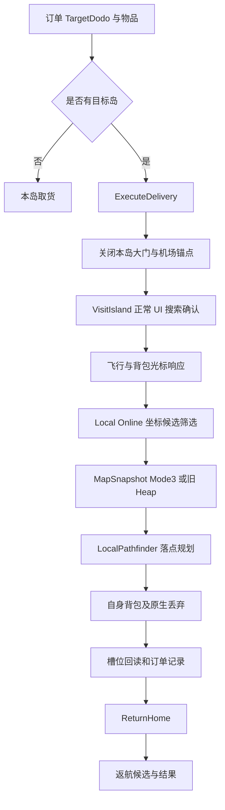
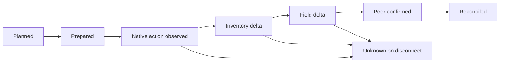

# ACNH 3.0.3 跨岛自动派送与 Native 指针研究

> [!abstract] 结论
> 机器人以正常机场 UI 进入获得邀请的岛，读取自己的在线地图副本，规划落点，使用自己的背包及游戏正常丢弃动作交付。现有实现另外使用直接坐标写入及背包注入；此类操作不是原生移动或丢弃 ABI。研究仅针对自有主机、离线快照和岛主同意的测试；不修改第三方地图、不绕过访问许可。
>
> 本轮实际复核 C# 源码及两个仓库已经提交的 ELF/Ghidra 研究成果。未重新读取认证原始 ELF、未连接 Switch、未运行 CI；引用的原始汇编由历史报告提供。所有 Native 替换均须独立实机验收。

## 1. 证据、地址空间与关联文档

- S1：代码实际使用；E2：已有原始 ELF 指令、重定位或 vtable 证据；D1：已有反编译语义；R2：实机跨状态双读。E2 不推出 R2。
- M = MainBase；H = HeapBase；P(a) = 从地址 a 读取 little-endian u64；Ghidra VA = Main RVA + 0x100000。数组的最后一跳为加法，不再解引用。
- [[01-ELF地址空间与证据等级]]、[[02-全局根槽与Native对象]]、[[04-Heap到Main根指针与存档结构]]、[[07-保存管理器与玩家村民动态根]]、[[09-保存后端析构与玩家Payload]]
- 原始源码固定版本：[CrossBot.cs](https://github.com/969981/SysBot.ACNHOrders.CHS/blob/5ed3009dc57d59bbfa86c31d51045d8826e64abb/Bot/CrossBot.cs)、[OffsetHelper.cs](https://github.com/969981/SysBot.ACNHOrders.CHS/blob/5ed3009dc57d59bbfa86c31d51045d8826e64abb/Bot/ACNHMobileSpawner/OffsetHelper.cs)、[DodoPositionHelper.cs](https://github.com/969981/SysBot.ACNHOrders.CHS/blob/5ed3009dc57d59bbfa86c31d51045d8826e64abb/Bot/Helpers/DodoPositionHelper.cs)。
- 历史 ELF 证据：[Mode3 生命周期](https://github.com/969981/SysBot.ACNHOrders.CHS/blob/5ed3009dc57d59bbfa86c31d51045d8826e64abb/docs/09-reverse-engineering/acnh-3.0.3-mode3-owner-creation-release.zh-CN.md)、[SelfActor](https://github.com/969981/SysBot.ACNHOrders.CHS/blob/5ed3009dc57d59bbfa86c31d51045d8826e64abb/docs/09-reverse-engineering/acnh-3.0.3-self-actor-transform-native-warp-xref.zh-CN.md)、[八阶段诊断](https://github.com/969981/SysBot.ACNHOrders.CHS/blob/5ed3009dc57d59bbfa86c31d51045d8826e64abb/docs/09-reverse-engineering/acnh-3.0.3-eight-phase-pointers-and-self-actor-readonly-diagnostic.zh-CN.md)、[玩家 Payload](https://github.com/969981/ACNH_Resources/blob/fb58d34153d5ad67289476e9f54b08231ed75e9a/docs/Native-Pointer-Research-3.0.3/09-保存后端析构与玩家Payload.md)。

## 2. 订单与跨岛流程



|方法|源码行|职责|
|---|---:|---|
|ExecuteOrder|1457|TargetDodo 分流|
|ExecuteDelivery|1054|等待场景、占位背包、关门、Anchor 2/3、飞行监控|
|VisitIsland|367|机场对话、密码输入、目标岛搜索、航班、抵达|
|WaitForArrivalByBackpack|230|背包光标响应检测|
|TryVerifyPlayerPointer|743|双读坐标、有限 float、状态 marker、候选歧义拒绝|
|ExecuteDeliveryDrops|3456|在线快照、落点规划、投递、结果|
|MovePlayerToGridAsync|1374|坐标写入与同址回读|
|ReturnHome|1306|离岛交互、会话退出与 Overworld 二次检查|
|MapSnapshot.LoadAsync|41|四层地图读取|
|LocalPathfinder.FindStandPoints|150|容量密度、站立点、最近邻|
|PocketInjectorAsync.Write|109|双区背包验证及写入|

行号以固定 SysBot ref 为准。旧 remote-delivery.md 尚有过时描述：坐标探测已经只读，返岛增加了会话二次判断，MapSnapshot 已尝试 manager-first 只读路径。

## 3. 指针清单（旧 Heap，不等于已证明的稳定根）

|字段|H 相对偏移|含义|
|---|---|---|
|InventoryOffset|0xB27BB758|背包第二区候选|
|BackpackCursorPointer|0x43E0599C|背包光标四字节候选|
|DodoAddress|0x0A2A7E44|本岛 Dodo 缓冲|
|OnlineSessionAddress|0x094A1748|legacy 活动 byte|
|TextSpeedAddress|0x0BDA29FC|对话速度|
|ChatIdAddress|0x0BD9BFE0|机场对话 ID|
|isChatEnded|0x0BD9C014|名称有歧义：实际等待 1 代表对话开始/中|
|isConversationLoaded|0x0BD9CAE0|对话加载|
|CustomNameLocAddress|0x0A1B6388|搜索到的目标玩家名|
|CustomVillageLocAddress|0x0A1B636C|搜索到的目标岛名|
|ArrivedCustomNameLocAddress|0x09F9A910|抵达后对方玩家名候选|
|ArrivedCustomVillageLocAddress|0x09F9A8F4|抵达后目标岛名候选|
|ArrivedCustomNIDAddress|0x09F9A5E0|网络身份字段，日志禁止原值|
|OnlineSessionVisitorAddress|0x09F8FFB0|访客显示列表；stride 0x448|
|ActiveFieldItemStart|0xB3B55890|在线物品层|
|ActiveFieldItemStart1|0xB5BACD08|第二候选，非当前生产根|
|ActiveTerrainStartOnline|0xB3C24E90|在线地形|
|BuildingOffsetOnline|0xB3C49A90|在线建筑|
|AcreOffsetOnline|0xB3C49E3C|在线地块|
|OnlineActiveFieldBaseDiagnostic|0xB3B49890|从旧 item 基址减 0xC000|

|Main RVA|对象与等级|
|---|---|
|0x5474040|SaveDataMgr，E2|
|0x527D558|OnlineSubsystemOwner，E2|
|0x526C708|OnlineMachine 生命周期记录，E2|
|0x4B60F48|Pia/NEX 根，E2；Dodo 同屏未证|
|0x59E6A60|OnlineMatch 根，E2|
|0x526D370|固定 UTF-16 string object；非已证 Dodo|
|0x4BFAE30|Actor registry，E2；Self 身份未证|
|0x4627088|旧 PlayerIdentityFixer 候选；历史 ELF 报告指出位于 rodata，不能当作 singleton|
|0x4AA9CD8|旧 ChatCoordJumps 根 S1；UI Manager 未证|

## 4. Mode3 在线 Field 生命周期（P0）

```text
mgr = P(M+0x5474040)
storage = P(mgr+0x10)
slot = P(storage+0x1A0)
primary = P(slot+0x10)
secondary = P(slot+0x18)
resolver = P(slot+0x20)
registry = P(slot+0x38)
field = primary+0x1E728
```

注意 primary、resolver、registry 是不同对象。历史 ELF 文档已经证明两个 0x14C618 Auxiliary 分别分配构造并注册。

|Main RVA|历史原始指令|解释|
|---|---|---|
|0x26046F8|MOV W21,#0xC618|大小低位|
|0x26046FC|MOVK W21,#0x14,LSL#16|形成 0x14C618|
|0x2604724|BL 0x2478C0|分配 primary|
|0x260472C|BL 0x25D8DC0|构造 auxiliary|
|0x2604734|STR X22,[X20,#0x10]|保存 primary|
|0x2604788|BL 0x2478C0|分配 secondary|
|0x2604790|BL 0x25D8DC0|构造 auxiliary|
|0x2604798|STR X21,[X20,#0x18]|保存 secondary|
|0x2604F78|LDR X8,[X23,#0x10]|取 storage|
|0x2604F80|STR X20,[X8,#0x1A0]|登记 Mode3|
|0x2604FC0|STRB W8,[X23,#0x510]|写 mode flag|
|0x2605178|LDR X0,[X20,#0x1A0]|清理入口取 slot|
|0x2605188|BLR X8|vtable+0x48，获取 registry key|
|0x2605210|BLR X8|vtable+0x08，析构|
|0x2605214|STR XZR,[X20,#0x1A0]|清空 slot|

Slot vtable = M+0x498BFB0；+0x08 -> 0x262B55C -> 0x262B60C（成员释放）；+0x30 -> 0x262B5EC（返回 +0x20）；+0x40 -> 0x262B5FC 与 +0x48 -> 0x262B604（返回 +0x38）。0x71FF48 和 0x25FD2DC 是历史报告中到 0x2603140 的两处直接 BL。析构对两块 auxiliary 和其他 view 进行释放，不可跨场景缓存 slot 指针。

```cpp
// 静态归纳，非原生 ABI；省略错误分支。
create_mode3() {
  slot.primary = allocate_and_construct(0x14C618);
  slot.secondary = allocate_and_construct(0x14C618);
  storage.mode3 = slot;
  register_view(slot.registry);
  update_mode_flags();
}
destroy_mode3() {
  unregister_view(slot.registry);
  destroy_slot_and_owned_members();
  storage.mode3 = nullptr;
}
```

[NativeSaveReadOnlyRouter](https://github.com/969981/SysBot.ACNHOrders.CHS/blob/5ed3009dc57d59bbfa86c31d51045d8826e64abb/Bot/Helpers/NativeSaveReadOnlyRouter.cs) 已被 MapSnapshot 调用：检查 mgr+0x510 & 6、legacy session=1、四区地址别名及 owner 前后稳定；失败后旧 Heap 回退。静态生命周期部分已经闭合，剩余工作为真实 mode 转移触发、当前场景所有权、完整四域实机验证。

## 5. Inventory Main 指针：与最新 GSavePlayer 研究合并（P0）

资源仓库最新 [[09-保存后端析构与玩家Payload]] 已给出双后端链，不应再把背包 Main 根记为完全未知。这里使用 **Ghidra VA** 引用函数，RVA 需减 0x100000。

```text
mgr=P(M+0x5474040); T=P(mgr+0x10)
mode=u8(mgr+0x453)&1
O=P(T+(mode?0x130:0))
R=P(O+0x20)
B=R+(mode?0:0x70)
ordinary:
  identity=P(R+0x78)+P(R+0x80)+0x1E33B0+i*0x48
  找到 mgr+0x90+k*8 == i 且 mgr+0x94+k*8 == 1 的 k
  W=P(T+0x60+k*8); G=P(W+0x20)
replacement:
  identity=P(B+0xE7120)+P(B+0xE7128)+i*0x48
  W=P(T+0x140+i*8); G=P(W+0x10)
D=G+0x194B0
if P(D+8)==0: D=P(mgr+0x20)
I=P(D+0x78)+P(D+0x80)
```

i 限 0..7，identity 首 16 字节不能全零；后端 vtable+0x38 真实目标 VA 0270BD50 / 02725C40，均为 LDR X0,[X0,#0x20]; RET。玩家访问 VA 026EED64 / 026EEC4C；背包消费者 VA 026759E0 (RVA 0x25759E0)。这里的两个 u64 相加是描述符载荷计算，不是普通 PointerAll。

|载荷|相对 I|旧 Heap 候选|
|---|---:|---|
|一组 20 slots|+0|H+0xB27BB6A0|
|该组 count|+0xA0|待实机|
|另一组 20 slots|+0xB8|H+0xB27BB758|
|该组 count|+0x158|待实机|
|钱包|+0x170|H+0xB27BB810|

每个槽 8B；两组间 0x18 元数据，总读区 0x170。旧偏移差与 Native 布局一致，但尚未证明当前机器人玩家、容量与实际物理地址相同。已有 [离线快照比较工具](https://github.com/969981/ACNH_Resources/blob/fb58d34153d5ad67289476e9f54b08231ed75e9a/Scripts/acnh303_save_snapshot_compare.py)，无需重复创建猜测链。使用认证 Build ID 的 coherent offline manifest 验证身份、两个 count、全部槽与旧地址关系，保存文件映射单独核验；不调用游戏虚函数、不改变生产写入。

## 6. SelfActor 与光标 UI（P0）

旧 Local {0x4BFAE30,0x18,0x178,0xD0,0xD8}；Online {0x4BFAE30,0x18,0x08,0x178,0xD0,0xD8}。指向 Vec3 候选：+0/+4/+8 XYZ；+0x20 raw marker 0xC0066666（float -2.1，非确认的原生状态枚举）。

|RVA|证据|
|---|---|
|0x88A6B0 / 0x88A6B4|root+0x10 双向链表哨兵初始化|
|0x88A6C0|发布 root 全局槽|
|0x838C5C|LDR X10,[X19,#0x278]，注册 node|
|0x838C78|STP X9,X11,[X10]，插入链表|
|0x838C8C|STR W9,[X8,#0x20]，更新 count|
|0x838C94|STRB W8,[X19,#0x289]，登记标志|
|0x838DC0|清零注销 node|
|0x838DCC|更新 count|
|0x88A4D8|清全局 root|

root+0x18 是动态链表关系，不保证是受控玩家。0x15F8870、0x1F1A0F0 及 0x163302C 具有三 float 写入证据，但未与受控对象闭合；0x22315CC 是历史 vtable+0x100 writer 候选，不能直接命名为安全 SetPosition。下一步需要关联 input/controller、player index、session identity 与 registry node；避免取首尾节点冒充 Self。

光标：旧四字节缓冲 FF xx FF 00 的第 1 字节，00/01 切换只证明 UI 可操作，不证明目的岛。Main UI root 尚未取得可信证据。研究路径：正常打开/关闭背包、左右切换、切页、换语言的只读时间序列；从 UI 生命周期和光标 getter/写入者定位 UI manager；验证空指针、重建与 index 范围。拒绝把普通 UI 响应当作 Actor 或目标岛身份。

## 7. 机场、联机会话与返岛（P0/P1）

VisitIsland 正常 UI 输入目标五位码，读搜索结果后确认航班；旧 ChatId=17 用于失败处理。密码输入由 DodoCodeInput 键位模型处理，不直接注入网络密码。旧冻结文本速度与 UI 延迟仍需验证；确保退出路径释放冻结。

```text
owner=P(M+0x527D558)
machine=P(owner+0x00)
session=P(owner+0x10)
machineState=u32(machine+0x508)
sessionState=u32(session+0x3E0)
accessMode=u32(session+0xAA8)
```

历史研究指出 machine state=4、session state=7 均为活动候选；Host/Connect 可能共享 established。Open/Close 状态候选 9/8；+0xAB0 为 transition/completion 候选，并非通用在线位。Pia/NEX selected session 从 root+0x162 index、+0x168 table 获得，+0x120 string object 与 +0x140 RPC 工作区必须区分；不能把原生输出直接当成 UI Dodo 或将 ReissuePassword 网络任务误命名为重发 Dodo。

Home identity 与 target identity 必须独立比较：出发前保存本岛非公开标识的脱敏摘要，搜索结果与抵达后的 scene/session 身份一致才算目标确认；返航需 session 退出、Overworld 双读及 home identity 一致。当前 ReturnHome 为 void、超时只记录日志，仍无法保证完成。真正稳定的岛屿 owner/身份字段待追；不输出 NID 或 Dodo 原文。

## 8. 地图四层与投放点（P1/P2）

|层|Field 偏移|当前读取|完整结构注意|
|---|---:|---:|---|
|Item|0xC000|192*192*8=294912|历史证据完整可玩窗口 224*192*8=0x54000|
|Terrain|0xDB600|112*96*14=150528|地形格与物品格不同|
|Building|0x100200|46*20=920|原生区域上界 0x3AC|
|Acre|0x1005AC|160|地块/附加参数|
|总计||446520|不是完整 Field 大小|

GridToWorld: X=5*gx+165，Z=5*gy+165。WorldToGrid 逆向四舍五入。现有 Item 索引 (192*x+y)*8，Terrain 快照索引 ((x/2)*96+y/2)*14（整数除法）。TerrainHelper.IsGrassLand 使用 672*x+7*y，不保证与奇数网格快照一致，必须统一坐标域。

MapSnapshot IsWalkable 检查建筑、禁区、物品、地形低 4 位及 Acre 0/4。规划安全区 26..199 / 26..165，但当前 Item 数据仅覆盖 x<192；未知格不能视为空。建筑广场/机场有启发式禁区。FindStandPoints 使用容量 1.5 倍目标、15..50 窗口、6 格步长、九宫格偏移 -2/0/2、至少 6 空格、曼哈顿距离评分与贪婪最近邻，额外留 5 个备用点；不是 A* 路径。当前移动保留初始 Y，未验证高度、碰撞和权威同步。建议使用正常移动及岛主指定的区域，未知地形或场景拒绝继续。

## 9. 原生 DropItem 与事务证据（P0/P1）

当前 ExecuteDeliveryDrops 先填占位物品（2505），通过背包菜单执行正常丢弃交互；订单项序列化为 NHSE Item 的 8B 数据。源码采用槽位清空为成功证据，更新原订单索引为 NONE，并记录站立点而非真实物品落点。地图仅为示意，非同步证明。主循环检查完整 8B，fallback 仅检查前四字节；快照又使用 16 位 ID 判空。不能把三者当同一语义。

现有 C# 代码没有直接调用 Native DropItem。原生链应从正常丢弃 UI 状态 handler 到 Item eligibility、背包扣除、Field placement、网络事件及保存确认逐层核查。原版 ItemKind 静态 flag 不保证可丢弃或跨岛携带；见 [R84 限制证据](https://github.com/969981/ACNH_Resources/blob/fb58d34153d5ad67289476e9f54b08231ed75e9a/docs/ACNH303_R84_RUNTIME_ITEM_RESTRICTIONS_EVIDENCE.md)。本轮没有确认 DropItem Native RVA/ABI；禁止虚构地址或跳过游戏限制。

建议事务状态：

日志键 order-id + item-index + attempt-id；记录前后槽位摘要、授权落点、地图 delta、会话 epoch；未确认不能自动复投，避免重复；交付与返航分开记状态。只读观测普通合法物品在同意测试岛上的正常丢弃，分别确认本机和岛主观察结果。

## 10. 代码风险与验收

|优先级|问题|当前状态/处理|
|---|---|---|
|P0|TryVerifyPlayerPointer 原写 Z 探测|已改为只读；Self 身份仍待证|
|P0|MapSnapshot 使用固定 Heap|已接入 Native router；回退仍依赖旧 Heap|
|P0|ReturnHome 只判断场景|已增加 session 二次检查；无明确结果/岛身份|
|P0|部分派送返回 Success|L3883-3911 仍无条件 Success|
|P0|PocketInjector.Write 返回值|L1072、3537、3627、3803 未检查结果|
|P0|绝对 ptr 生命周期|L3458 缓存一次，跨状态未重新绑定|
|P0|槽位为空即确认交付|缺真实落点/对端/掉线回滚证据|
|P1|地图宽度与物品层不一致|未知区拒绝规划，完整窗口需 R2|
|P1|三套空槽判定|统一严格规则并测试|
|P1|初始高度复用|无原生高度与碰撞证据|
|P1|实时读仍用旧 Heap|使用同 epoch 快照 owner 的只读 provider|
|P2|批量读取|原生 router 0x4000 分块，先测 I/O 耗时再优化|

## 11. 下一阶段 16 项研究任务

|优先级|任务|已有证据及验收门槛|
|---|---|---|
|P0|Mode3 创建与销毁|E2 分配/注册/虚表/释放已闭合；完整场景 R2|
|P0|Inventory Main|E2/D1 双后端及 payload 已恢复；玩家身份、快照与旧 Heap 别名|
|P0|背包光标 UI Manager|S1；确定 UI owner、getter/writer、生命周期|
|P0|SelfActor 完整链|E2 registry；controller→identity→node→transform 闭合|
|P0|Host 与 Client 状态|E2 候选；跨角色状态矩阵|
|P0|目标岛/主岛身份|S1；独立 token 与会话/场景一致|
|P0|丢弃事务证据|S1；per-item journal、对端确认、掉线 unknown|
|P1|机场对话 Main|S1；UI 状态与实际 owner/XREF|
|P1|Native DropItem|未确认；正常交互 handler→合法性→落点→同步调用链|
|P1|坐标与真实落点|站立点不是物品格；前后地图差分|
|P1|高度碰撞可通行|现为启发式；原生消费者及场景验证|
|P1|统一地图源|统一 epoch、未知格 fail closed|
|P2|批量地图性能|命令数、字节数、p50/p95、错误率|
|P2|机场输入/飞行性能|按阶段测量，不盲目减等待|
|P2|地图与订单记录|真实落点与事务状态，脱敏|
|P2|Build ID 指针数据库|复用现有 registry，分开 static 与 runtime flags|

建议先完成 Inventory + SelfActor + Mode3 + DropItem 四专题；其余随证据链推进。不能将本轮文档提交等同于实机验证。

## 12. 可复现与阶段矩阵

已有工具：[ELF manager 校验](https://github.com/969981/SysBot.ACNHOrders.CHS/blob/5ed3009dc57d59bbfa86c31d51045d8826e64abb/docs/research/tools/verify_acnh303_elf_managers.py)、[Actor XREF 校验](https://github.com/969981/SysBot.ACNHOrders.CHS/blob/5ed3009dc57d59bbfa86c31d51045d8826e64abb/docs/research/tools/verify_acnh303_actor_transform_xrefs.py)、[Mode3 ABI 校验](https://github.com/969981/SysBot.ACNHOrders.CHS/blob/5ed3009dc57d59bbfa86c31d51045d8826e64abb/docs/research/tools/verify_acnh303_manager_first_field_abi.py)、[Build ID registry](https://github.com/969981/ACNH_Resources/blob/fb58d34153d5ad67289476e9f54b08231ed75e9a/derived/3.0.3/external_pointers/build_id_pointer_index.json)。资源侧先运行既有 offline comparator 的 selftest，再导入合法 coherent offline capture；真实快照与原始 ELF 不随文档提供。

|阶段|应独立观察|
|---|---|
|离线本岛|Home identity、玩家身份、背包两组与 UI owner|
|Host 开门|Machine/Session、mode、actor registry|
|Client 搜索|目标摘要、UI 状态|
|飞行|旧绝对指针失效、所有写入暂停|
|目标岛抵达|Client role、scene、SelfActor、Mode3 owner|
|打开背包/正常丢弃|UI 变化、Inventory delta、Field delta、对端可见性|
|掉线|epoch 失效，未知事务待对账|
|返航|session inactive、home identity、重新解析 owner|

验收分别记录 S1/D1/E2/R2、Build ID、原始地址空间、函数/行号、原始指令或 blob、捕获 SHA、重复验证次数。至少跨三次启动/不同岛及 Host/Client，数据缺失明确标 UNVERIFIED，不默认继承旧版本。
