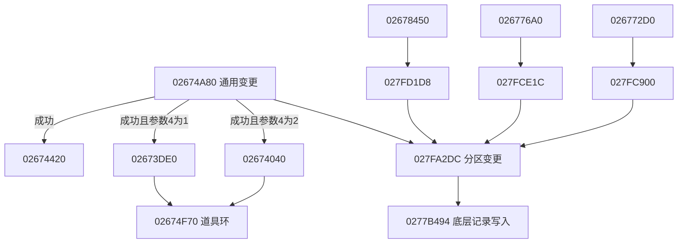

# 跨岛派送 · 背包扣减与道具环证据

关联 [[10-跨岛派送指针与Native交付链]]、[[11-跨岛派送与赠礼ELF函数导航]]、[[09-保存后端析构与玩家Payload]]、[[01-ELF地址空间与证据等级]]。

本轮实际读取六个核心 Ghidra C 文件及后续消费者；调用者搜索覆盖 GitHub 当前默认分支索引，并在 3.0.3_Unpack 重新读取选中函数。搜索不是 ELF 全量 XREF，不保证覆盖间接调用。VA - 0x100000 = Main RVA 为既有地址转换约定；本轮未取得原始 ELF 机器码、Build ID 或实机快照，不提高运行时证据等级。所有语义命名为研究命名。

## 1. 调用链



## 2. 核心函数逐语句组审计

- [02674A80](../../derived/3.0.3/ghidra12.2/c/4a/02674a80.c): 全局 DAT_05574040 非空检查；026EEC4C 解析玩家；0277D6C4 派生目录 ID；目录对象 +0x57E58 下 +0x1F8/+0x1D8/+0x1E0 完成索引及非空检查；条件调用 02649BF0（语义未闭合）；选择后端；读取旧绑定；回调守卫与描述符通知；调用 027FA2DC；成功后按参数4选择 02674040 或 02673DE0；最终 02674420。不能命名为 DropItem。
- [027FA2DC](../../derived/3.0.3/ghidra12.2/c/a2/027fa2dc.c): 读取 +0x158 并截断到20；逻辑槽位先访问 +0xB8 物理分区；否则索引减去第二物理分区容量，访问 +0x000。两分支复制8字节临时记录，0277E56C、条件 01B09918，再分别调用 0277E788/0277E8B4 校验。0277B494 成功才清除该分区绑定为 FF。
- [0277B494](../../derived/3.0.3/ghidra12.2/c/b4/0277b494.c): 参数1须非负且小于容量；复制两个32位值；标准化及目录条件处理；参数5 bit0 分流；通过虚函数取得槽位地址后写入 +0 u16、+2 u8、+3 u8、+4 u32；可选输出标准化记录。虚表具体目标及字段 Native 名称未闭合。
- [02674040](../../derived/3.0.3/ghidra12.2/c/40/02674040.c): 读取变更后的物品；通过描述符守卫清除槽位绑定；01ADBE40 条件成立后调用 02674F70，传递旧绑定值。
- [02673DE0](../../derived/3.0.3/ghidra12.2/c/3d/02673de0.c): 清除槽位绑定；根据输入物品构造元数据对象；01ADBE40 成功后以 026750D0 计算值交给 02674F70。
- [02674420](../../derived/3.0.3/ghidra12.2/c/44/02674420.c): 玩家 +0x1A80 和 +0x1A88 读取值相加形成关联记录地址，+0x1AA0 提供守卫；02816430/028169A0 读取关联记录及索引；从背包重取相应物品；02816C30 更新记录，描述符范围 0x8B8。不是 Field 更新证据。028169A0 使用 +0x8B1 和 +0x8B0 的分区选择；其固定20索引编码与背包动态容量映射的适配关系需复验。

## 3. Payload / 后端

|字段|静态证据|
|---|---|
|Main+0x5474040|SaveDataMgr 根槽，既有 ELF 研究|
|SaveDataMgr+0x20|默认后端指针|
|Player+0x194B0|内嵌后端描述符|
|Player+0x194B8|选择条件|
|Player+0x19548|回调指针字段|
|Backend+0x78 / +0x80|两个读取值相加形成 payload，不是连续解引用|
|Backend+0x98|回调容器；+0/+8/+0x10/+0x18/+0x20 的目标尚未解析|
|Payload+0x000|20×8 字节物理分区 A|
|+0xA0 / +0xA4|A 容量 / 20 字节绑定|
|+0xB8|20×8 字节物理分区 B|
|+0x158 / +0x15C|B 容量 / 20 字节绑定|
|+0x170|历史钱包相邻字段，本轮不复验|
|+0x178|容量等级 0/1/2 对应20/30/40；超范围按0处理（026750D0 消费者）|

描述符通知长度实际为 0x17C，不应把物品与绑定区 0x170 当成整个描述符范围。

```cpp
// 只读结构解读伪代码，不是原版源码或可执行写入接口
capacityB = min(read_u32(payload + 0x158), 20);
if (slot < capacityB) return 0xB8 + 8 * slot;
index = slot - capacityB;
if (index >= min(read_u32(payload + 0xA0), 20)) return Invalid;
return 8 * index;
```

## 4. 道具环证据

[02674F70](../../derived/3.0.3/ghidra12.2/c/4f/02674f70.c) 原始字符串 ItemRingEnable；param_3 bit7 条件决定是否检查该开关；相同函数写入 +0xA4/+0x15C 的绑定字节。[026750D0](../../derived/3.0.3/ghidra12.2/c/50/026750d0.c) 依 20/30/40 容量遍历绑定编号，支持道具环语义。0xFF 为清除状态；其它编号及高位完整枚举待核对。两分区校验器均允许首字段 -2（0xFFFE），且调用相同 01B14730；不能由此直接推断跨岛携带权限。

## 5. 调用者分类（非穷举）

|调用者|源码行|已观察到的行为|
|---|---|---|
|[007E2520](../../derived/3.0.3/ghidra12.2/c/25/007e2520.c#L43-L52)|43–52|遍历槽位，条件成立后同槽两次通用变更|
|[02208760](../../derived/3.0.3/ghidra12.2/c/87/02208760.c#L159-L173)|159–173|组装记录并同槽两次变更|
|[02208B30](../../derived/3.0.3/ghidra12.2/c/8b/02208b30.c#L180-L195)|180–195|类似记录替换|
|[027F63D4](../../derived/3.0.3/ghidra12.2/c/63/027f63d4.c#L185-L199)|185–199|查找 0x76 对应槽位并更新两名玩家候选|
|[027D3750](../../derived/3.0.3/ghidra12.2/c/37/027d3750.c#L2299-L2306)|2299–2306|多重条件后使用默认记录变更|
|[027FCE1C](../../derived/3.0.3/ghidra12.2/c/ce/027fce1c.c#L112-L132)|112–132|按数量比较、变更或清槽；清槽分支不检查底层返回值|
|[027FC900](../../derived/3.0.3/ghidra12.2/c/c9/027fc900.c#L152-L169)|152–169|跨槽匹配及数量扣减|
|[027FD1D8](../../derived/3.0.3/ghidra12.2/c/d1/027fd1d8.c#L103-L171)|103–171|两槽物品与绑定交换；忽略两个变更返回值并返回1|
|[026776A0](../../derived/3.0.3/ghidra12.2/c/76/026776a0.c#L16-L68)|16–68|身份索引和状态检查、玩家获取、描述符通知、按槽扣减|
|[026772D0](../../derived/3.0.3/ghidra12.2/c/72/026772d0.c#L16-L68)|16–68|同类封装，按物品扣减|
|[02628C90](../../derived/3.0.3/ghidra12.2/c/8c/02628c90.c#L381-L398)|381–398、492–506|对象列表移除后按槽扣1；列表不是已证实的 Field|
|[02613AC0](../../derived/3.0.3/ghidra12.2/c/3a/02613ac0.c#L158-L179)|158–179|复制记录进入列表、累计数量并调用扣减；第三参数在反编译中丢失，需 ELF 寄存器复验|
|[00DBEC80](../../derived/3.0.3/ghidra12.2/c/ec/00dbec80.c#L120-L135)|120–135|条件分流到另一入口或按物品扣减|
|[0321D3B0](../../derived/3.0.3/ghidra12.2/c/d3/0321d3b0.c#L119-L127)|119–127|累加10个字节字段后按指定记录扣减|

026776A0 和 026772D0 均检查身份索引 <8 以及表记录 +0x13D4/+0x13D6 等状态，随后调用 02583354(DAT_055021A0, identity, 1)。DAT_055021A0 对应候选 Main RVA 0x54021A0，尚无本轮原始重定位复验；不能将其直接视为自身角色或在线身份。

## 6. 交付验收与未闭合关系

背包变更成功不等于交付成功；部分消费者甚至忽略下层返回值。应在授权离线快照及正常交互中分别观察背包物品数量、绑定字节、目标 Field 变化、当前角色与岛身份及会话代次。仅观察本地扣减不得将订单判定为完成；线上同步语义尚未恢复，不能宣称完成同步验证。

|优先级|下一步|验收|
|---|---|---|
|P0|026776A0 / 026772D0 上游完整 XREF|原始 ELF BL/BLR、参数寄存器、调用分类|
|P0|02613AC0 / 02628C90 对象列表|构造、所有权、消费者、是否连接 Field|
|P0|背包 UI Drop handler|UI 菜单选择到业务函数的真实 CFG|
|P0|Mode3 Field 与玩家身份|独立快照对照，代次失效检查|
|P0|地面物品生成|正常丢弃前后 Field 差分与生产者证据|
|P1|02674420 关联记录|解析 +0x8B0/+0x8B1 和分类9|
|P1|道具环|绑定值枚举和条件覆盖|
|P1|联机同步|消息/状态生产者与消费者；仅授权环境验证|

## 7. 证据索引

|Ghidra VA|Main RVA|研究语义|读取时 C blob SHA|
|---|---|---|---|
|[02674A80](../../derived/3.0.3/ghidra12.2/c/4a/02674a80.c)|0x2574A80|通用背包变更入口|ea1cfce75255f9ead9bdcc2376a30e62234f9fb2|
|[027FA2DC](../../derived/3.0.3/ghidra12.2/c/a2/027fa2dc.c)|0x26FA2DC|分区校验与变更|1a6105d70ef8756ae884f28b1665a49f23bf5601|
|[0277B494](../../derived/3.0.3/ghidra12.2/c/b4/0277b494.c)|0x267B494|底层8字节写入|e08311038914ad5324fb96c16f9dc609ac28e235|
|[02674420](../../derived/3.0.3/ghidra12.2/c/44/02674420.c)|0x2574420|关联记录更新|ccf1fe70d41b2d3c502f02f7688849bd31f2d78a|
|[02674040](../../derived/3.0.3/ghidra12.2/c/40/02674040.c)|0x2574040|绑定恢复分支|3d8e204d154af43268680bbf41b39765a31adfe6|
|[02673DE0](../../derived/3.0.3/ghidra12.2/c/3d/02673de0.c)|0x2573DE0|绑定重算分支|268bd3193d326b241112ca681ee5a214c2f30859|
|[02674F70](../../derived/3.0.3/ghidra12.2/c/4f/02674f70.c)|0x2574F70|ItemRingEnable 与绑定写入|e7a1fda8be9db8ee53502854c7d05774b48ef861|
|[026750D0](../../derived/3.0.3/ghidra12.2/c/50/026750d0.c)|0x25750D0|容量等级与绑定遍历|9fdece05d9a33d08e0ecb2fb3fd47b707124f458|
|[0277E788](../../derived/3.0.3/ghidra12.2/c/e7/0277e788.c)|0x267E788|分区校验 A|4dfc633c219bdf53257ab889d719607697bab82d|
|[0277E8B4](../../derived/3.0.3/ghidra12.2/c/e8/0277e8b4.c)|0x267E8B4|分区校验 B|6e8ff297babe59027a18bd08ee0d8c86d4bb9dac|
|[02816430](../../derived/3.0.3/ghidra12.2/c/64/02816430.c)|0x2716430|关联记录读取|eedec85c6c27af0ac4b17545c24b0ce638d2a499|
|[028169A0](../../derived/3.0.3/ghidra12.2/c/69/028169a0.c)|0x27169A0|关联槽位读取|9fb1115641a3c98da846282cd70b4d62e30ed06a|
|[02816C30](../../derived/3.0.3/ghidra12.2/c/6c/02816c30.c)|0x2716C30|关联记录更新|12b26ab744de7b74b4b175e1de9fc1f1ac78ff27|
|[026772D0](../../derived/3.0.3/ghidra12.2/c/72/026772d0.c)|0x25772D0|按物品扣减封装|308997b1b7b5acabb08921f3c6dd01d83c76402b|
|[026776A0](../../derived/3.0.3/ghidra12.2/c/76/026776a0.c)|0x25776A0|按槽位扣减封装|47e71dbfa4085ba4a7785fa7569bd0e1b82f4699|
|[027FC900](../../derived/3.0.3/ghidra12.2/c/c9/027fc900.c)|0x26FC900|按物品匹配扣减|0190d596c7bc1594a7884fd820e4ad48f71134f5|
|[027FCE1C](../../derived/3.0.3/ghidra12.2/c/ce/027fce1c.c)|0x26FCE1C|按槽位扣减|7c5d06758ed72bbf0931fc7d1d7fe064941494c2|
|[027FD1D8](../../derived/3.0.3/ghidra12.2/c/d1/027fd1d8.c)|0x26FD1D8|双槽交换|f4f2cfd06a1c0610626d46b5704c57f05225caec|

未执行原始 ELF 指令验证、实机验收或生产代码修改。本页只记录静态反编译证据，不提升 Build ID 指针数据库的运行时验证状态。
