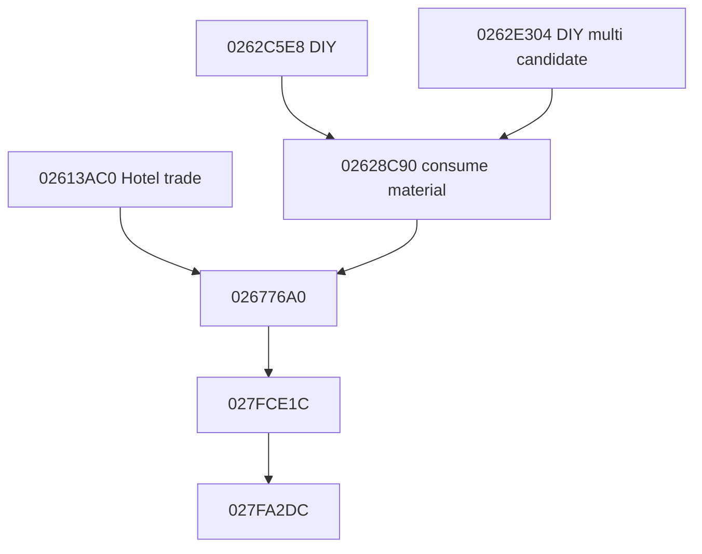

# 旅馆交易与 DIY 材料消费排除审计

[[13-跨岛派送背包扣减与道具环证据]] · [[10-跨岛派送指针与Native交付链]] · [[11-跨岛派送与赠礼ELF函数导航]]

## 1. 结论及证据范围

02613AC0 的后段包含 HotelDiyTradeAchieveOrderNum、HotelUnlockItemFromPoint、hotel_trade_item 等字符串；02628C90 的两个已找到调用者包含 DIYItem、DIYTool、DIYFurniture、DiyCount 等字符串。前者是旅馆 DIY 交易，后者是制作材料消耗子程序。两者作为正常背包 DropItem 直接入口的候选应降级排除；仍是有效 Inventory 消费证据。静态反编译不能证明绝不存在其他调用者。

VA - 0x100000 = RVA 沿用历史约定。本轮未读取原始 ELF/NSO 二进制，未验证 Build ID，未进行实机测试。GitHub 搜索不是全量 ELF XREF。所有命名为研究标签。

## 2. 02613AC0 旅馆订单交易（892行）

源文件 [02613AC0](../../derived/3.0.3/ghidra12.2/c/3a/02613ac0.c)，blob 050f80b648b769c57ab41ba8aade88eec5e17eb0。

|C 源码行|证据|
|---|---|
|66–89|身份索引小于8；全局对象非空；02613470 校验，02612F30 读取订单，按 ID 位图选择物品解析|
|91–101|初始化栈上有界临时列表：count/capacity、指针数组与三项节点链接|
|102–155|遍历背包，跳过特定槽位与绑定状态，匹配物品，计算数量|
|156–174|复制 8 字节物品记录到临时节点，计数，调用 026776A0；数量足够后 02614D60|
|175–291|取得玩家后端，选择订单描述符，更新状态字节并调整相邻订单排序值|
|293–546|重复处理相邻订单记录；具体每分支原始寄存器待复验|
|547–782|ReserveFirstTradeBonus 及 HighPriceTradeOrderBonus 系列字段|
|783–820|交易计数、DIYTrade 及 PE_DIY_Trade|
|822–849|HotelUnlockItemFromPoint、hotel_trade_item|
|850–889|交易后续通知及返回值|

[02612F30](../../derived/3.0.3/ghidra12.2/c/2f/02612f30.c) 显示后端 +0x2D1A8 + index*0x38 的描述符访问，index 取低字节，若 param_3 & 0xFC 非零则 fallback 首项。描述符 +8 和 +0x10 两个读取值相加得到载荷，+0x28 为守卫。载荷 +0 u16、+2/+3/+5 u8 被打包返回；+4/+5 状态更新见主函数。+0x2D1E0、+0x2D218、+0x2D250 为相邻候选描述符；边界条件及字段原名仍待验证。[02613470](../../derived/3.0.3/ghidra12.2/c/34/02613470.c) 验证数量和物品条件，[02614D60](../../derived/3.0.3/ghidra12.2/c/4d/02614d60.c) 消费临时物品列表并处理交易计算。

注意 02613AC0 的 026776A0 调用只反编译出两个实参，而被调函数签名有三个；不得推断 W2 的真实值。原始指令复验前不声称确切扣减量。未找到此函数的文本直接调用者，不能据此宣称无调用者。

## 3. 02628C90 材料列表结构（552行）

源文件 [02628C90](../../derived/3.0.3/ghidra12.2/c/8c/02628c90.c)，blob 72e2254808223d7b909f19f86e5db679064d0bfe。

|字段|已观察到的访问|
|---|---|
|owner+0x77510|活动候选数量 i32|
|owner+0x77514|候选容量 i32|
|owner+0x77518|候选节点指针数组|
|owner+0x77520|空闲链表头|
|active node+0|背包槽位 index i32|
|active node+4|物品派生评分 float|
|free node+0|下一空闲节点指针（覆盖活动数据）|

|C 源码行|证据|
|---|---|
|54–90|读取材料记录、数量与来源计数；材料索引步长 0x18，开始于 param_2+0x2C|
|91–118|分类位图；分类9分支回收旧节点、清空活动数量|
|119–152|UpgradePocket40 / UpgradePocket30 决定背包遍历范围|
|153–200|读取背包、匹配材料、由 01AE5538 派生评分，特定槽位加0.5；从空闲链表获取节点|
|201–287|按浮点评分排序|
|288–399|选择、归还节点、memmove 压缩指针数组；按槽扣1|
|401–512|另一数量条件下重复选择扣减|
|517–547|普通材料走 026774C0；条件分支走 0267DBB0|

列表节点不是已证明的 Field 地面物品 Actor。实际 owner 类型、构造和释放入口待 ELF 追踪。不能从 C 文本唯一命中宣称构造不存在。

### 材料记录

param_2 + 0x2C + i*0x18（调用者明确 i=0..5）：

|偏移|读取|
|---|---|
|+0x00|8字节物品记录|
|+0x08|u16 需求数量|
|+0x0C|i16 条件字段|
|+0x10/+0x12|两个 u16，求和后参与扣减分支|
|+0x14|上游分流用 u16，非零时走另一库存处理|

字段精确业务命名和来源存储类型尚未闭合。

## 4. 已证实上游

- [0262C5E8](../../derived/3.0.3/ghidra12.2/c/c5/0262c5e8.c#L52-L85)：遍历六项材料；53、59、65、71、77、83 行调用 02628C90。127–173 行 DIYItem、DIYTool、DIYFurniture、DiyCount 等。
- [0262E304](../../derived/3.0.3/ghidra12.2/c/e3/0262e304.c#L180-L225)：184、192、200、208、216、224 行调用同一材料函数，301–350 行含 DiyCountMultiMake 等。
- [026776A0](../../derived/3.0.3/ghidra12.2/c/76/026776a0.c#L16-L68)：身份检查、后端描述符、按槽数量扣减。



目前文本搜索得到 026776A0 的三个调用表达式位置（02613AC0 一处，02628C90 两处），不是原始 ELF 全量 XREF。

## 5. 重新定位普通交互

|候选|已观察到的事实|未闭合|
|---|---|---|
|[03196960](../../derived/3.0.3/ghidra12.2/c/69/03196960.c#L501-L507)|DAT_05701710 = PocketMenu|字符串不是 UI Manager 根|
|[03190D10](../../derived/3.0.3/ghidra12.2/c/0d/03190d10.c#L590-L607)|消费 PocketMenu 字符串、身份字节 +0x1F8、调用 030DED60|可能为事件/消息/统计分发，未证明丢弃菜单处理|
|[03454A44](../../derived/3.0.3/ghidra12.2/c/4a/03454a44.c#L26-L80)|cPutFtr、cPutFtrForInterior、cPutUnitIcon、cPutUnitIconForInterior 状态注册，记录步长 0x40|回调语义及正常丢弃分支|
|[03189918](../../derived/3.0.3/ghidra12.2/c/99/03189918.c#L174-L187)|cPutItemForInterior 注册，回调 LAB_0318F4BC/0318F534|室内状态不能等同室外 DropItem|

03454A44 中 cPutFtr（1）回调候选 LAB_03456C78/03456C80；cPutFtrForInterior（2）LAB_03456EA0/03456EB0；cPutUnitIcon（3）LAB_03457054/03457060；cPutUnitIconForInterior（4）LAB_03457250/03457260。均是 C 导出的 LAB 标签，不认定函数起点，需结合 ELF 和状态分发。

Mode3、SelfActor、Inventory 三链维持各自独立身份与生命周期证据；本轮无新增 Host/Client、Field 生产者、地图落点或同步确认。

## 6. 原始 ELF 复现

新增 [direct XREF 审计脚本](../../Scripts/acnh303_delivery_direct_xrefs.py)，使用既有解码器，只扫描原始 NSO 与 ELF 字节匹配的可执行 text 区域，记录 B/BL immediate 候选位置、原始四字节、VA/RVA、SHA256、Build ID。线性扫描可能将嵌入数据误判为指令，仍需函数 CFG 验证；不覆盖间接 BLR/BR、虚表和函数指针。脚本新增但本轮未运行。

```bash
python Scripts/acnh303_delivery_direct_xrefs.py --selftest
python Scripts/acnh303_delivery_direct_xrefs.py --root . --out artifacts/delivery-direct-xrefs
```

## 7. 下一阶段

|优先级|研究任务|验收条件|
|---|---|---|
|P0|复验 026776A0 的 B/BL 与 W2|真实原字、函数归属、参数数据流|
|P0|PocketMenu 消费者与真正 UI 事件|区分菜单消息与处理器|
|P0|cPutFtr/cPutUnitIcon 状态回调|追到物品生产者、区分摆放和丢弃|
|P0|Mode3 Field、自身角色、岛身份|只读快照与独立生命周期|
|P0|Host/Client|自有测试环境正常交互对照|
|P1|DIY owner 构造、空闲池生命周期|构造器、容量初始化及析构|
|P1|订单描述符完整字段|原始 ELF 与保存快照对照|
|P1|关联记录、道具环、守卫虚函数|各自原生消费者和状态枚举|
|P2|Build ID 数据库|真实字节与快照验收后才升级|

未修改生产派送代码，未向已验证指针数据库填入新运行时地址。

## 8. 后续定位结果

见 [[15-PocketMenu与PutUnitIcon原生状态机]]。030DED60 是提示文本/按键图标处理候选；真实 cPocketMenu 构造链已确认，资源 PutUnitIcon 对应普通地面投放，Throw 为独立菜单操作。回调锚点本轮没有 C 文件，原始 ELF 尚待验收。
