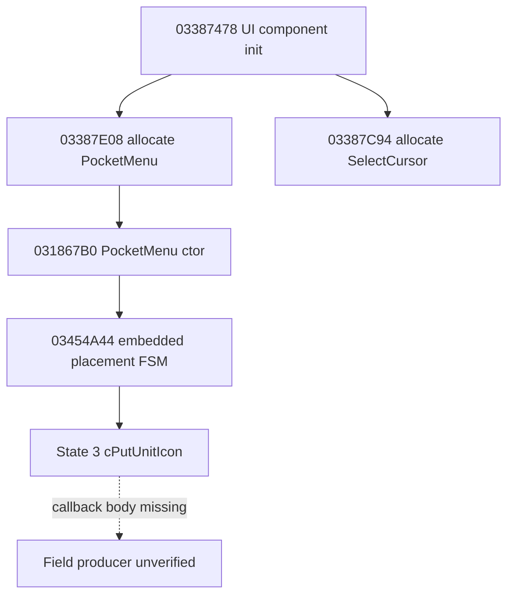

# PocketMenu 与 PutUnitIcon 原生状态机

[[14-旅馆交易与DIY材料消费排除审计]] · [[13-跨岛派送背包扣减与道具环证据]] · [[10-跨岛派送指针与Native交付链]]

## 1. 原版菜单资源纠正

实际读取 [ItemUIContextMenu.csv](../../UnPack/1/Bcsv/ItemUIContextMenu.csv)（blob f0a408702901d29aac0e53cc4e146554677e72c9）及 [字段元数据](../../UnPack/1/Bcsv/ItemUIContextMenu.json)（blob 82e692e56142f2bd61142bc78964781de35674a2）：66 行、每条140字节、6字段。原始 BCSV 尚未在本轮重新读取。

|行索引|原始行偏移|200DD382|54706054|F2CE6E17|87BF00E8|026F0892|036E8EBE|
|---|---|---|---|---|---|---|---|
|23|3296|101|11|1|PutFtr|0111|この辺に飾る|
|30|4276|110|10|0|PutUnitIcon|0110|この辺に置く|
|42|5956|750|33|1|Throw|0120|捨てる|

正常地面投放的资源名称是 PutUnitIcon，而非 Throw。菜单数值字段10不是已证明的运行时 switch index；状态3也不是同一编号体系。元数据字段偏移为4/6/8/9/41/73，宽度提示2/2/1/32/32/67；真实字段原名和类型尚待消费者证明。

## 2. PocketMenu 提示文本路径（排除直接 Handler）

[03190D10](../../derived/3.0.3/ghidra12.2/c/0d/03190d10.c#L590-L607) 读取 DAT_05701710，组装字符串和身份字节，调用 [030DED60](../../derived/3.0.3/ghidra12.2/c/ed/030ded60.c)，后者复制两组字符串并调用 [030DEEEC](../../derived/3.0.3/ghidra12.2/c/ee/030deeec.c)。030DEEEC 含 STR_KeyIcon，调用 033FBEF0 与 01BEA210/01BEA9C8/01BE9EB8。提示文本/按键图标处理是强静态解释，不宣称该整个调用链不会间接影响其他 UI 状态。

|对象偏移|观察行为|
|---|---|
|+0x408/+0x410|资源处理上下文|
|+0x418/+0x470|字符串描述符|
|+0x420/+0x478|字符串缓冲区指针|
|+0x428/+0x480|容量|
|+0x490|身份 u8（>=8归一到FF）|

独立证据：[035913FC](../../derived/3.0.3/ghidra12.2/c/13/035913fc.c) 使用 WorkBenchRemakeSelect 后调用同一函数；[02EB8854](../../derived/3.0.3/ghidra12.2/c/88/02eb8854.c) 使用 Report。该函数非 PocketMenu 专属，不作为丢弃业务入口。

## 3. 真正的 cPocketMenu 构造及状态机

[03387478](../../derived/3.0.3/ghidra12.2/c/74/03387478.c#L22-L34) 创建 SelectCursor 保存于组件所有者 +0xD0，创建 cPocketMenu 保存于 +0x88，两者所有者不是已证明的 Main 全局根。 [03387E08](../../derived/3.0.3/ghidra12.2/c/7e/03387e08.c) 分配 0x1C520 字节，调用 031867B0；将第二所有者指针存至对象 +0x98，设置 +0xA8 状态，初始化并在第二所有者 +0xF0 互斥锁保护下登记链表。对象 +0x98 指向工厂/登记管理者，不保证等于 03387478 的第一个参数。 [03387C94](../../derived/3.0.3/ghidra12.2/c/7c/03387c94.c) 对 SelectCursor 分配 0x288，调用 03200224。

### PocketMenu 构造字段

[031867B0](../../derived/3.0.3/ghidra12.2/c/67/031867b0.c) 行号与观察：

|字节偏移|含义/证据|
|---|---|
|+0|PTR_FUN_04B06E28 虚表地址候选（行40）|
|+0x1F8|u8 身份字段，来自配置 +0xE，>=8归一FF（30–37）|
|+0x1FC|配置 +0x10 的 u32（37）|
|+0x268|清零和初始化内部数组起点，270项、步长0x1A8（52–66）|
|+0x1C2D0|内嵌放置状态机（113–135）|
|+0x1C318|相对状态机 +0x48 的字段，消费者 03456B90|
|+0x1C320|相对状态机 +0x50 的8字节物品记录（118–123）|
|+0x1C340|相对状态机 +0x70 的8字节记录，初始化首字段FFFE（130–131）|

最后两项为记录，不能直接等同于当前高亮槽位；+0x1F8 也不是背包光标。候选全局根及真实运行时指针仍待证明。

## 4. 放置状态机结构及分发

[03454A44](../../derived/3.0.3/ghidra12.2/c/4a/03454a44.c) 调用 [03EBAC90](../../derived/3.0.3/ghidra12.2/c/ac/03ebac90.c) 分配9个0x40字节状态记录及0x10步长名称表；[03EBAF40](../../derived/3.0.3/ghidra12.2/c/af/03ebaf40.c) 处理 :: 名称后缀并写入名称表。

|状态机偏移|观察|
|---|---|
|+0x08/+0x0C|当前状态值及相邻值（末尾状态切换逻辑）|
|+0x10/+0x14|之前 +8/+C 的备份|
|+0x18|初始化状态值，末尾复制到+8|
|+0x1C|请求状态数量|
|+0x21|初始化时置1|
|+0x28|状态记录容量|
|+0x30|状态记录数组|
|+0x38/+0x40|名称表容量/地址|

|state record offset|观察|
|---|---|
|+0x00|PTR_LAB_04B2AFA8 共享回调包装候选|
|+0x08|状态机 owner|
|+0x10/+0x20|两处回调标签|
|+0x18/+0x28/+0x30/+0x38|初始化0|

|ID|名称|+0x10 / +0x20|
|---|---|---|
|0|cIdle|03456B90 / 03456C74|
|1|cPutFtr|03456C78 / 03456C80|
|2|cPutFtrForInterior|03456EA0 / 03456EB0|
|3|cPutUnitIcon|03457054 / 03457060|
|4|cPutUnitIconForInterior|03457250 / 03457260|
|5|cCreateRemakeUI|03457408 / 0345740C|
|6|cPrePutFtrRemake|03457534 / 0345753C|
|7|cPrePutFtrRemakeForInterior|03457994 / 0345799C|
|8|cSystemDialog|03457DB0 / 03457E8C|

[03456B90](../../derived/3.0.3/ghidra12.2/c/6b/03456b90.c) Idle回调：条件调用0369FE54，再清空 +0x58/+0x60/+0x68、复制默认物品记录至 +0x50/+0x70，+0x4C/+0x78置FF，+0x7C清零。具体业务字段语义需其他消费者。

多个对象构造器复用 03454A44，例如 03157D00（+0x258）、030747A0（+0x16B0）、02D5EAAC（+0x1C348）；故不能把任意放置状态机实例都当作自身 PocketMenu。

## 5. 证据缺口与验收

03457054/03457060 仅以 LAB 标签出现在注册函数中，分别读取对应 C 文件返回404。不能据此构造伪代码或推断其原始指令。需要以真实 ELF/NSO 查找这两个锚点的指令及跳转，确认函数边界和包装器分发。

本轮未取得原始 ELF/NSO 文件、未运行直接 XREF 扫描，未验证 Build ID，未实机测试。已观察的静态结构不可写入已验证地址库。

|优先级|研究任务|验收|
|---|---|---|
|P0|03457054/03457060 与共享包装器|原始字节和有界 CFG，区分标签与函数入口|
|P0|菜单值10 到状态3|查明资源消费者及 UI 选择事件，不假设编号映射|
|P0|PocketMenu owner 与全局根|构造、发布、注销、Main 动态根及独立身份|
|P0|SelectCursor 与真实槽位|追踪03200224及逻辑索引消费者|
|P0|Field producer 与 Inventory 关联|正常交互的只读快照差分与业务证据|
|P0|Host/Client|自有测试岛、同意对端及会话代次对照|
|P1|ItemRing/关联记录/描述符虚表|独立消费者和原始枚举|
|P2|Build ID|仅在原始字节与运行时证据验收后升级|

## 6. C blob 证据

|文件 VA|blob SHA|
|---|---|
|03190D10|0a74e4b1de54d11a791e641182bb6b2109f5c11e|
|030DED60|cc1fc7ca8c94c84ad0121b13eff9e6ca4cdbbcdd|
|030DEEEC|1dd78d7ed9d1db3ac319eee11e18f336b20f53fa|
|03387478|7baa480e936ca84e1161abd8e9fcefdc8c7b7e4d|
|03387E08|32e0a4cd6f981109bfe28f672ead281111032776|
|03387C94|83a795f5a6655e34272f1bc5ff07cf7999ba5526|
|031867B0|e33954a253a30a8e12b73992412281793f3c1a40|
|03454A44|51187e3d9498a892fe34894f985cdefe1c93c3fe|
|03456B90|db0638812457d28a8c22e0a9fd9c1cf8223ed8e5|
|03EBAC90|f71525d67eb75aa9f62e4429f8b2301967cc8788|
|03EBAF40|ffe6bffdabb049e5efb473898b5b17d342dc6cdf|
