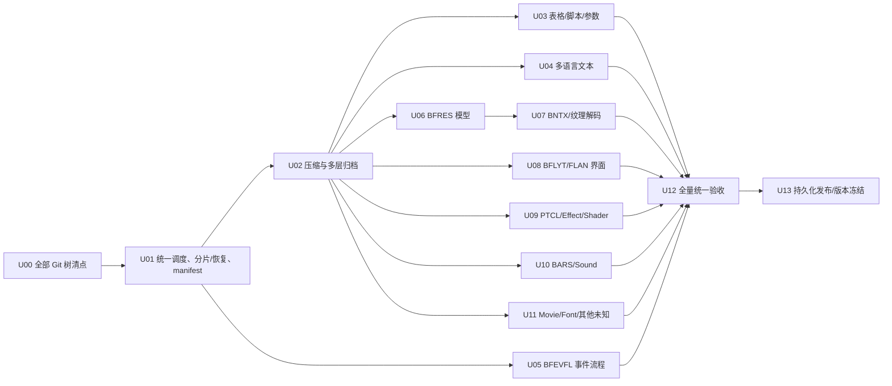

# ACNH 3.0.3 — 全资源解包工程总目标与阶段门

> 范围：`e10617820db06889e1638499478da0de_NCA/1` 内 **全部 Git 跟踪的 RomFS 文件**。对应 ExeFS `.../0` 单独清点与 ELF 研究。基准版本固定 3.0.3；不得把其他版本结构假定为兼容。
>
> 基线、数量、字节规模以 Actions 生成的 `derived/3.0.3/inventory/source_inventory_summary.json` 和 `source_manifest.csv.gz` 为准，**不得由 GitHub contents API 返回的前 1,000 项推断总量**。项目源文件可能超过数 GB，不允许整个仓库多次重复拷贝/提交。

## 一、"全部解包" 的四个不同验收层

| 层 | 明确定义 | 全量目标 | 目前的限制 |
| --- | --- | --- | --- |
| L0 原资源建档 | 不读大 blob 就枚举全部源路径、大小、Git blob ID；实际运行时补 SHA-256 | **100% RomFS 文件**，每文件仅一条主 manifest | 不能把 Git blob SHA-1 当文件 SHA-256 |
| L1 压缩层 | 按魔数正确展开 Zstandard `.zs`、Yaz0 `.szs` 等真实压缩封装 | 识别到的有效封装全部可解；CRC/限额/异常可追溯 | 展开后是容器或专有二进制，并非直接 JSON |
| L2 归档层 | 对 SARC / SZS / PACK / 内嵌归档递归列成员，验证区间/名称/hash；安全提取成员 | 有效容器全部可查、可提取，递归直到叶子或明确阻塞 | 必须解决多层、同名、超大成员、内存限额和路径冲突 |
| L3 内容转换 | 文本→CSV/JSON；事件→图 JSON/可读代码；纹理→PNG/KTX2；模型→GLB/glTF；音频→WAV/FLAC（只有有效可解码时） | 每个叶子都按格式获得最有用、真实、可审计的输出 | shader/particle 等可能没有一对一通用格式；必须保留原始叶子及结构反射，不伪造可运行代码/渲染图 |

**最终完成判定**：L0 全量覆盖；L1/L2 可验证格式转换覆盖 100%；L3 每个可解析格式有专门解析器、有效输出和测试；确实无法可靠解码的原生专有资源要单列 `partial/unsupported` 的明确技术原因和缺失能力，不得用 `.json` 文件头替代"解完了"。统计要分别呈现源文件覆盖率、归档层完成率、格式级内容完成率，不许以 0 个未扫描文件偷换 100% 完整解码。

## 二、规范输出目录（保持来源镜像）

```text
<NCA>/1/Model/XXX.Nin_NX_NVN.zs            # 原始资源：严格只读
Unpack/<NCA>/1/Model/XXX.sarc                # L1 解出的真实 archive，视体积只发 Release
Unpack/<NCA>/1/Model/XXX/_members/output.bfres   # L2 叶子，不能丢掉
Unpack/<NCA>/1/Model/XXX/_converted/model.glb    # L3 真实 glTF 变换
Unpack/<NCA>/1/Model/XXX/_converted/materials.json
Unpack/<NCA>/1/Model/XXX/_converted/textures/*.png

<NCA>/1/EventFlow/ABC.bfevfl
Unpack/<NCA>/1/EventFlow/ABC.json             # graph/nodes/actors/params/links
Unpack/<NCA>/1/EventFlow/ABC.evfl.txt         # 可信反编译才生成

Unpack/_meta/source_inventory.csv.gz         # Git tree (L0)
Unpack/_meta/manifest.jsonl.gz                # 对全部文件统一审计；支持大体积
Unpack/_meta/formats.csv
Unpack/_meta/unsupported.csv
Unpack/_meta/errors.csv
Unpack/_meta/coverage.json
Unpack/_meta/sha256.txt
derived/3.0.3/reports/<run-id>/...             # Actions 分片报告/统计
```

- 所有原始路径与大小写保持不变；子档案、同名后缀、Windows casefold 冲突必须在预演阶段检测。
- 对原始二进制只读。中间的 `.sarc` 等可大到 GB，不默认提交 Git；缺口通过 Release 永久分片和 SHA-256 清单补齐。
- JSON/CSV 统一 UTF-8、明确 schema 版本、稳定排序。BNTX 的多纹理、多 mip/ASTC 解码必须有真实像素检查。BFEVFL 需要正确可达边/Actor/参数，而不是随便抽字符串。
- **分组测试报告**可放 `derived`；只有聚合/验证后才更新 `Unpack/_meta/coverage.json` 的全量状态。不能让某次 `--file` 覆盖掉上次 `--all` 的全量统计。

## 三、路线图 / 先后依赖



## 四、每个任务的 Definition of Done（DoD）

1. 有工具/解析器及 Python smoke + 至少一个真实 3.0.3 样例回归；不支持输出清晰报错。
2. 真正运行 GitHub Actions 批处理；保存输入、输出 SHA-256、原始相对路径、格式、输出数、状态、失败原因和工具版本。
3. 数据可实际使用：CSV 可读；JSON 有已证明字段；PNG 能解码且尺寸匹配；GLB 可由标准 glTF 检查器读取；WAV 文件头/采样/播放时长验证；图结构有闭合有效引用。
4. `source_total = converted + partial + unsupported + failed`，每个源文件出现一次，不允许漏项或未知状态混入 converted。递归成员另建 child manifest，不与原始文件计数相加。
5. 整体 `failed=0`，`missing=0`，`hash_mismatch=0`，`collision=0`；`unsupported`/未完整 L3 必须有独立缺口清单，不能在没有验证时写"100%"。
6. 产物可以复现，目录与原文件双向映射；分组报告归档，体积与 Release/LFS 预算合理。

## 五、Actions 与发布约束

- 不同时运行 19 个全量下载任务，先按 Git 目录分片与源大小分箱，`max-parallel: 3-4`；使用 `blob:none` 与 sparse-checkout 控制 Git 下载体积。
- 首先用 1-3 个真实样本打开新解析器 CI，再全类别执行；首失败保留 logs，不无限重试。
- CI 工件**并非永久仓库内容**，14/30 天到期即可能消失。小型结构化内容进入 `Unpack/`；大批量 GLB/PNG/WAV/SARC 进入 GitHub Release 分卷并附 SHA-256、包索引和源路径映射。
- 超过 Git 100 MiB 单文件限制时禁止直接 Git blob；使用 Releases 或经核准的 LFS 配额。遵循 GitHub 平台与版权/分发规则。
- 已有 `scripts/unpack_acnh.py`、`scripts/acnh303_asset_batch.py` 是可复用起点；前者已有 BCSV/BYML/MSBT，后者已具备 EventFlow 图、SARC 索引、BARS 元数据，**但二者 manifest/路径与能力必须合并**。
- 当前 19 分片执行记录：<https://github.com/969981/ACNH_Resources/actions/runs/38385428097>。不因 jobs "queued/in_progress" 声称全量完成。

## 六、分阶段交付优先级

- **P0：可信基础** — U00/U01/U02。保证全量清点、分片、校验/恢复、多层档案可取。
- **P1：高价值可读数据** — U03/U04/U05。全部 BCSV/BYML/Message/EventFlow JSON/CSV/脚本文本。
- **P2：资产转换** — U06/U07/U08/U10。全部模型、纹理、UI、声音的可用常规格式。
- **P3：专有/长尾** — U09/U11，以及 U12/U13 的最终核验、发布。

请在每次 PR 中引用对应 Issue，记录真实输入/成功/失败计数，最终清单永远以生成的 inventory 和全量 manifest 为准。
